# Playback Failure Scenarios & Log Accounting

This document captures detailed timelines, cross-component accounting, and root-cause analyses for live TV streaming failures observed during playback. These empirical incident reports serve as architectural reference cases to drive resiliency, stream stability, and watchdog design improvements in `tablo2hdhomerun`.

---

## 1. System Topology & Test Environment

| Component | Identifier / IP | Version / Details | Role |
| :--- | :--- | :--- | :--- |
| **Tablo Tuner** | `192.168.2.28:8887` / `:80` | Tablo 4th Gen (`SID_5087B856F43D`) | Hardware tuner, ATSC demodulator, HLS packager |
| **tablo2hdhomerun** | `192.168.2.24:8080` | Scala 3.x / Pekko ([tablo2hdhomerun:29f9c76](file:///home/bdina/git/tablo2hdhomerun/src/main/scala/app/stream/ResilientHlsSource.scala)) | HDHomeRun API emulator, HLS demuxer/proxy |
| **Plex Media Server** | `192.168.2.24:32400` | PMS `v1.43.4.10903` (Docker container) | Network tuner client, VAAPI hardware transcoder (Intel HD Graphics 530) |
| **Plex Client** | `192.168.2.50` | Plex for iOS `v2026.19.1` on iPad (iOS `17.7.11`, `B9A0D6A9-1428-4C5C-9D93-4F69ED4983E4`, User: `bdina`) | Downstream player |
| **RF Broadcast Transmitter** | Needham, MA (~45–50 miles south) | WBZ-TV (CBS 4.1, Physical UHF RF Channel 20) | OTA broadcast origin |
| **Weather Observation Station** | KMHT (Manchester-Boston Regional Airport, NH) | Surface Meteorological Station | Local weather & wind reference |

> [!NOTE]
> **Timezone Alignment**:
> - `tablo2hdhomerun` logs in **UTC**.
> - `Plex Media Server` logs and local weather observations are in **EDT (UTC-4)**.
> - In this document, all timeline entries list both timestamps for correlated analysis.

---

## 2. Executive Summary of Incident

On the evening of **`2026-10-13`**, an extended viewing session streaming CBS Channel 4.1 (`S20431_004_01`) spanned **3 hours 41 minutes** (`17:43:06 EDT` – `21:24:25+ EDT` / `21:43:06 UTC` – `01:24:25+ UTC`), capturing multiple distinct failure phases driven by wind-induced ATSC RF interference and compounding proxy fast-attach behaviors.

This scenario represents the exact operational failure pattern `tablo2hdhomerun` is intended to eliminate: **weather-induced OTA signal degradation causing downstream transcode crashes and fatal client playback errors, ejecting the end-user to the menu and forcing repeated manual re-tunes that repeatedly fast-attach to the same corrupted tuner lock rather than auto-healing.**

> [!IMPORTANT]
> **Key Finding from Plex Container Logs**:
> Every single manual re-tune by the user was **directly triggered by the Plex client terminating playback due to fatal playback errors, not because the video was frozen for too long and the user voluntarily stopped playback.** 
> 
> Detailed analysis of the Plex Media Server container logs (`Plex Media Server.log` and `Plex Transcoder Statistics.*.log`) confirms that in each instance, corrupted ATSC data caused packet rejections, stalled HLS segment downloads, and ultimately a fatal FFmpeg transcoder process crash (`Transcode runner appears to have died`). These failures broke container delivery, causing the Plex iOS client on the iPad to abort playback with an unrecoverable error and return to the channel guide, compelling the user to manually click the channel to restart playback.

### Key Session Metrics:
- **Total Observed Window**: 3 hours 41 minutes 19 seconds
- **Continuous Hardware Tuner Lease**: Single Tablo lease (`0bac4485`) held continuously via `idle-grace`
- **Downstream Streaming Sessions**: 4 client connection intervals (Session 1: 159 min, Session 2: ~60 min, Session 3 Attempt 1: 29s, Session 3 Attempt 2: Active)
- **Watchdog Auto-Retunes**: **0** (Proxy watchdog failed to recognize corrupted video payload)
- **Manual Human Interventions**: **3 manual re-tune operations**, each forced because the Plex client encountered a fatal playback error and terminated the session
- **Transcode Crashes**: **1 fatal process exit** (`Transcode runner appears to have died` at `21:22:22 EDT`)
- **Plex Container Log Evidence**: Verified in `Plex Media Server.log` and `Plex Transcoder Statistics.{1..5}.log`

### Summary of Failure Progression:
1. **Prolonged Baseline Stability (159 minutes)**:
   - Initial cold tune completed at `17:43:06 EDT` under lease `0bac4485` (client `56d5989d`, transcode `04b68454-12bd-4574-ae8d-f0d4ccea8662`).
   - The stream delivered steady MPEG-TS video through early evening despite gusty winds.
2. **Environmental Trigger (Wind Gusts up to 29–32 mph)**:
   - Regional observations at KMHT recorded gusty conditions across Southern New Hampshire (5:53 PM: 20 mph, **gusting to 29 mph**; 7:53 PM: 15 mph, **gusting to 22 mph**).
   - WBZ-TV broadcasts on UHF RF Channel 20 from Needham, MA (~45–50 miles away). Wind gusts induced mechanical mast sway and moving foliage along the transmission path, introducing severe 8VSB dynamic multipath interference and carrier phase jitter.
3. **Session 1 Playback Error Termination (`20:19 – 20:22 EDT`)**:
   - At `20:04:49` and `20:13:34 EDT`, FFmpeg decoder rejections occurred (`Error submitting packet to decoder: Invalid data found when processing input`).
   - At `20:19:43` – `20:20:19 EDT`, a sustained wind gust caused a massive cascade of corrupted macroblocks.
   - In `Plex Transcoder Statistics.5.log`, transcode segment 9502 (`startOffset="9501892"`) shows the client download began (`startTime="9506491"`) but **never completed** due to stream starvation.
   - Because Tablo continued trickling fragmentary bytes across HTTP, `tablo2hdhomerun`'s `StallWatchdog` (zero bytes for 5s) never tripped.
   - Starved of valid frames and unable to download segment 9502, **the Plex iOS client on the iPad threw a fatal playback error and terminated playback at `20:22:14 EDT`** (disconnecting from the proxy and reporting stopped state to PMS via timeline `Req#43581` at `20:22:23 EDT`).
   - Ejected to the Plex UI, the user was forced to manually click CBS 4.1 at `20:22:32 EDT` to re-tune. The proxy fast-attached client `310da765` without resetting the Tablo's ATSC tuner lock.
4. **Session 2 Degradation & Fatal Transcode Crash (`20:22 – 21:22 EDT`)**:
   - Re-attaching to the unreset carrier lock left the stream permanently vulnerable. Over the next hour, continuing wind gusts produced dozens of macroblock errors across 16 distinct timestamps.
   - At `20:55:42 EDT`, another decoder rejection occurred (`slice below image (153 >= 68)`).
   - At `21:22:22.299 EDT`, after another dense macroblock cascade, the downstream transcoder collapsed completely: `WARN [Req#55c95/Transcode/d193fa07...] Transcode runner appears to have died.`
   - With the transcode runner dead, the transcoder pipeline was severed. PMS logged `downloadContainer: expected MediaContainer element, found html` (`Req#55c34`) as the container collapsed.
   - **The Plex client immediately encountered an unrecoverable playback termination error and exited**. Client `310da765` dropped at `21:22:22.212 EDT`, entering a 75-second `idle-grace`.
5. **The Fast-Attach Loop (`21:22 – 21:24 EDT`)**:
   - At `21:22:46 EDT`, the user re-selected the channel in Plex to recover from the crash. The proxy **fast-attached again** (`clientId=52cf844f`) to the exact same degraded lease.
   - Transcoder session `3fb82b77` started, but in `Plex Transcoder Statistics.2.log`, transcoding only progressed for 25.6 seconds (segment 25) before the stream corrupted completely.
   - Unable to sustain playback on the damaged stream, **the client threw another playback error and terminated within 29 seconds (`21:23:15 EDT`)**.
   - At `21:23:21 EDT`, ejected to the menu again, the user was forced to re-tune a third time. The proxy **fast-attached yet again** (`clientId=556b60fe`), spinning up transcode session `090d46f4`.

---

## 3. Incident Timeline & Log Accounting

### 3.1 Session Metadata
- **Channel**: CBS 4.1 (`S20431_004_01` / WBZ-TV Boston, Physical UHF RF 20)
- **Hardware Lease ID**: `0bac4485` (Held continuously from `17:43:06 EDT` through `21:24+ EDT`)
- **Tablo Session Token**: `1942cd07-f955-4cf9-b452-fdcd99191b38`
- **Plex Client**: Plex for iOS `v2026.19.1` on iPad (iOS `17.7.11`, `192.168.2.50`, machine identifier `B9A0D6A9-1428-4C5C-9D93-4F69ED4983E4`, User: `bdina`)
- **Client & Transcode Breakdown**:
  - **Session 1 (`17:43:06 – 20:22:14 EDT`)**: Client `56d5989d-bdd5-482b-98b0-369a39b9402d` / Transcode `04b68454-12bd-4574-ae8d-f0d4ccea8662` (Terminated by client due to playback error after segment download stall)
  - **Session 2 (`20:22:32 – 21:22:22 EDT`)**: Client `310da765-1f8d-49bc-bb97-5c5ee927066d` / Transcode `d193fa07-d741-4607-b19f-0b2c9c2b96b1` (Terminated by client when transcode runner crashed)
  - **Session 3 Attempt 1 (`21:22:46 – 21:23:15 EDT`)**: Client `52cf844f-7b14-400b-8f52-5e994f6ddd1e` / Transcode `3fb82b77-4bf0-4d3f-80ac-26d7fb9d6107` (Terminated by client with playback error in 29s)
  - **Session 3 Attempt 2 (`21:23:21 – Ongoing EDT`)**: Client `556b60fe-b006-487e-9f2d-3e405796a885` / Transcode `090d46f4-a4d7-40f3-810b-39639aef9836`

---

### 3.2 Environmental & Meteorological Context (KMHT Weather)

Observations recorded at Manchester-Boston Regional Airport (KMHT), situated in the reception corridor for Boston OTA broadcasts into Southern New Hampshire:

| Local Time (EDT) | UTC Time | Sustained Wind | Wind Gusts | Direction | Sky & Weather Conditions | RF Propagation Impact |
| :--- | :--- | :--- | :--- | :--- | :--- | :--- |
| **11:53 AM** | **15:53** | 20 mph | **29 mph** | W | Overcast, cool | High foliage agitation; early multipath flutter |
| **02:53 PM** | **18:53** | 21 mph | **32 mph** | WNW | Overcast, breezy | Peak gust of the day; physical mast deflection |
| **04:53 PM** | **20:53** | 17 mph | **25 mph** | W | Overcast | Sustained breeze |
| **05:53 PM** | **21:53** | 20 mph | **29 mph** | WNW | Overcast, damp | **Session Start**: Strong gusts causing periodic packet jitter |
| **06:53 PM** | **22:53** | 13 mph | None recorded | NW | Overcast | Intermittent lull |
| **07:53 PM** | **23:53** | 15 mph | **22 mph** | WNW | Overcast, dusk | **Pre-Dropout**: Renewed gusts shaking antenna array |
| **08:19 – 08:22 PM** | **00:19 – 00:22** | ~12–15 mph | Estimated **20–25 mph** | WNW | Night | **Session 1 Fatal Error**: Deep RF notch filter effect on RF 20 |
| **08:53 PM** | **00:53** | 8–10 mph | None recorded | S/WNW | Overcast | Low surface wind; lingering upper-canopy motion |
| **09:19 – 09:22 PM** | **01:19 – 01:22** | ~5–8 mph | Variable | S | Night, damp | **Session 2 Fatal Crash**: Transcode runner dies under corrupt stream |
| **09:53 PM** | **01:53** | 5 mph | None recorded | S | Cloudy, cool | Light air |

---

### 3.3 Correlated Chronological Timeline

| UTC Timestamp | EDT Timestamp | Component | Event / Log Details | Significance |
| :--- | :--- | :--- | :--- | :--- |
| **21:43:06.718** | **17:43:06.718** | Plex PMS | `[Req#119af/Grabber/...] Unable to find title for item of type 5` | Plex initiates tune request for CBS 4.1 (`/auto/v4.1`). |
| **21:43:06.725** | **17:43:06.725** | Proxy | `[session] opening channelId=S20431_004_01 clientId=56d5989d... occupied=1` | Proxy receives request and starts cold tune to Tablo. |
| **21:43:18.838** | **17:43:18.838** | Proxy | `[channel] tuned leaseId=0bac4485 channelId=S20431_004_01 expires=21:46:18Z` | Tablo locks RF 20 and returns initial HLS playlist. |
| **21:43:18.883** | **17:43:18.883** | Proxy | `[stream:hls] emit label=0bac4485 count=3 firstSeq=1 lastSeq=3` | First 3 video segments emitted to Plex. |
| **21:43:19.350** | **17:43:19.350** | Plex PMS | `[Req#11a32/Transcode/04b68454.../TPU] Preparing driver ivd for GPU Intel HD Graphics 530` | Plex VAAPI hardware transcoder pipeline initializes. |
| **21:43:19 – 22:12:57** | **17:43:19 – 18:12:57** | System | Stable streaming playback | Stream runs cleanly across first ~30 minutes. |
| **22:12:58.696** | **18:12:58.696** | Plex Transcoder | `ERROR [mpeg2video @ ...] ac-tex damaged at 3 61` <br> `ERROR Warning MVs not available` | First sign of wind-induced signal flutter on RF 20. |
| **22:32:29.759** | **18:32:29.759** | Plex Transcoder | `ERROR [mpeg2video] 00 motion_type`, `mb incr damaged` | Brief macroblock corruption during evening breeze. |
| **23:47:40.866** | **19:47:40.866** | Plex Transcoder | `ERROR [mpeg2video] 00 motion_type`, `slice mismatch`, `skip with previntra` | Wind gusts pick up (KMHT gusting to 22 mph); slice sync disrupted. |
| **00:04:49.008** | **20:04:49.008** | Plex Transcoder | `ERROR [mpeg2video] slice below image (88 >= 68)` <br> `ERROR [vist#0:0/mpeg2video] Error submitting packet to decoder: Invalid data found when processing input` | **Decoder Rejection #1**: Damaged slice dimensions cause FFmpeg decoder to reject input packet. |
| **00:08:53.133** | **20:08:53.133** | Plex Transcoder | `ERROR [mpeg2video] 00 motion_type at 47 54`, `ac-tex damaged`, `slice mismatch` | Multi-block corruption from signal distortion. |
| **00:13:34.870** | **20:13:34.870** | Plex Transcoder | `ERROR [mpeg2video] slice below image (79 >= 68)` <br> `ERROR Error submitting packet to decoder: Invalid data found when processing input` | **Decoder Rejection #2**: Second packet rejection by FFmpeg. |
| **00:19:43.607** | **20:19:43.607** | Plex Transcoder | `ERROR [mpeg2video] 00 motion_type at 100 66`, `mb incr damaged`, `Warning MVs not available` | Wind gust deflects antenna; ATSC 8VSB equalizer loses lock. |
| **00:20:19.220** | **20:20:19.220** | Plex Transcoder | Dense cascade of 10+ decoder errors: <br> `00 motion_type at 59 23, 91 15, 57 26, 21 27, 86 17...` <br> `mb incr damaged`, `Warning MVs not available` | **Total Picture Collapse**: Video frame stream corrupted beyond recovery. Downstream player buffer starves. |
| **00:20:20 – 00:22:14** | **20:20:20 – 20:22:14** | Proxy | No watchdog trip occurs. | **Watchdog Blind Spot**: Tablo continues trickling fragmentary TS data across HTTP socket. `StallWatchdog` does not trip. |
| **00:21:22.985** | **20:21:22.985** | Proxy | `INFO [4thgen-channel-S20431_004_01] real data resumed after 4204ms` | Proxy reports bytes moving, unaware that downstream video decoding has halted. |
| **00:21:34.000** | **20:21:34.000** | Plex Transcoder Stats | `Plex Transcoder Statistics.5.log`: Segment 9502 (`media-09502.ts`) client download hangs (`Download startTime="9506491"`, never completes) | Transcoder queue congested; client segment delivery hangs indefinitely. |
| **00:22:14.821** | **20:22:14.821** | Plex Client / Proxy | `INFO [session] idle-grace channelId=S20431_004_01 duration=75s token=1942cd07...` | **Client Playback Error Termination #1**: Starved of decodable frames, Plex iOS client throws fatal playback error and aborts playback, closing connection to proxy. Proxy enters 75s idle-grace. |
| **00:22:23.785** | **20:22:23.785** | Plex PMS | `WARN [Req#43581] Timeline: Unknown metadata item 62328, using default completion duration multiplier` | PMS container log confirms iPad client reported playback stopped following the fatal error. |
| **00:22:32.787** | **20:22:32.787** | Plex PMS | `[Req#4359a/Grabber/...] Unable to find title for item of type 5` | **Manual User Re-Tune #1**: Ejected to the Plex UI by the client error, user clicks CBS 4.1 in guide to restart stream. |
| **00:22:32.794** | **20:22:32.794** | Proxy | `INFO [session] grace-cancel channelId=S20431_004_01 clientId=310da765...` <br> `INFO [channel] fast-attached channelId=S20431_004_01` | **Fast-Attach #1**: Proxy binds new client without cold-tuning Tablo. |
| **00:22:32.802** | **20:22:32.802** | Plex Transcoder | `ERROR [mpeg2video @ ...] Invalid frame dimensions 0x0.` (x8) | Initial transcode probe fails on mid-GOP packet boundary. |
| **00:22:35.121** | **20:22:35.121** | Plex PMS | `[Req#435f5/Transcode/d193fa07.../TPU] Preparing driver ivd for GPU Intel HD Graphics 530` | Second transcode session `d193fa07` starts and recovers picture. |
| **00:23:53 – 00:54:09** | **20:23:53 – 20:54:09** | Plex Transcoder | Recurring macroblock corruption bursts logged at `20:23`, `20:27`, `20:29`, `20:37`, `20:41`, `20:43`, `20:46`, `20:52`, `20:54` | The unreset tuner struggles with continuous RF errors. |
| **00:55:42.588** | **20:55:42.588** | Plex Transcoder | `ERROR [mpeg2video] slice below image (153 >= 68)` <br> `ERROR [vist#0:0/mpeg2video] Error submitting packet to decoder: Invalid data found when processing input` | **Decoder Rejection #3**: Massive vertical slice coordinate overflow (153 vs 68 max) causes packet drop. |
| **00:56:14 – 01:19:20** | **20:56:14 – 21:19:20** | Plex Transcoder | Dense bursts of `00 motion_type`, `ac-tex damaged`, `Invalid mb type in P-frame`, `slice mismatch` at `20:56`, `20:58`, `20:59`, `21:01`, `21:08`, `21:16`, `21:19` | Ongoing signal distortion degrades stream stability throughout the hour. |
| **01:22:22.191** | **21:22:22.191** | Plex Transcoder | `ERROR [mpeg2video] Invalid mb type in B-frame at 83 22` <br> `ERROR Warning MVs not available` | Final corrupt B-frame received by decoder. |
| **01:22:22.212** | **21:22:22.212** | Plex Client / Proxy | `INFO [session] idle-grace channelId=S20431_004_01 duration=75s token=1942cd07...` | **Client Playback Error Termination #2**: Stream collapse severs client player; iPad client aborts playback and disconnects. Proxy enters 75s idle-grace. |
| **01:22:22.299** | **21:22:22.299** | Plex Transcoder | `WARN [Req#55c95/Transcode/d193fa07...] Transcode runner appears to have died.` | **Fatal Transcoder Crash**: FFmpeg process aborts due to unrecoverable input stream corruption. |
| **01:22:27.122 – 01:22:38.976** | **21:22:27.122 – 21:22:38.976** | Plex PMS | `ERROR [Req#55c34] downloadContainer: expected MediaContainer element, found html` <br> `WARN [Req#55c34/55cc0/55ce4] Timeline: Unknown metadata item 62329` | PMS container pipeline collapses following transcoder crash; iPad client reports fatal termination to PMS. |
| **01:22:46.233** | **21:22:46.233** | Plex PMS | `[Req#55d15/Grabber/...] Unable to find title for item of type 5` | **Manual User Re-Tune #2**: Ejected to the Plex UI by the client crash, user clicks CBS 4.1 in guide to restart stream. |
| **01:22:46.241** | **21:22:46.241** | Proxy | `INFO [session] grace-cancel channelId=S20431_004_01 clientId=52cf844f...` <br> `INFO [channel] fast-attached channelId=S20431_004_01` | **Fast-Attach #2**: Proxy cancels grace and binds client `52cf844f` to the same compromised Tablo stream. |
| **01:22:46 – 01:23:11** | **21:22:46 – 21:23:11** | Plex Transcoder Stats | `Plex Transcoder Statistics.2.log`: Transcoder session `3fb82b77` only produces 25 segments (`25.6s`) before corrupt GOP boundaries abort stream output. | Transcode fails to stabilize on degraded carrier lock. |
| **01:23:15.291** | **21:23:15.291** | Plex Client / Proxy | `INFO [session] idle-grace channelId=S20431_004_01 duration=75s token=1942cd07...` | **Client Playback Error Termination #3**: Unable to maintain playback on compromised carrier lock, Plex iOS client aborts with error after 29s. Proxy enters 75s idle-grace. |
| **01:23:21.011** | **21:23:21.011** | Plex PMS | `[Req#55ec8/Grabber/...] Unable to find title for item of type 5` | **Manual User Re-Tune #3**: Ejected to the menu again, user re-selects channel 6 seconds later. |
| **01:23:21.019** | **21:23:21.019** | Proxy | `INFO [session] grace-cancel channelId=S20431_004_01 clientId=556b60fe...` <br> `INFO [channel] fast-attached channelId=S20431_004_01` | **Fast-Attach #3**: Proxy binds client `556b60fe` yet again to the existing lease. |
| **01:23:22.575** | **21:23:22.575** | Plex PMS | `[Req#55f2f/Transcode/090d46f4.../TPU] Preparing driver ivd for GPU Intel HD Graphics 530` | Third transcode session `090d46f4` initializes. |

---

## 4. Root Cause Technical Deep Dive

### 4.1 The Physics of Wind-Induced ATSC RF Dropout

ATSC 1.0 utilizes 8-level Vestigial Sideband (8VSB) modulation on a 6 MHz channel bandwidth. At UHF Channel 20 (506–512 MHz), the wavelength is approximately 59 cm (~23 inches).

At a distance of ~45–50 miles from the Needham broadcast tower:
1. **Dynamic Multipath Distortion**: Wind gusts (22–32 mph) agitate tree branches and tree canopies along the line of sight. Moving leaves and limbs create fluctuating reflected RF paths that arrive at the receiving antenna slightly out of phase with the direct signal.
2. **Antenna Mast Flex**: Wind pressure physically deflects the antenna mast by a few degrees. At 50 miles, a fraction of a degree change in antenna pointing angle causes significant phase cancellation and rapid shifts in signal-to-noise ratio (SNR).
3. **Equalizer Exhaustion**: The adaptive equalizer in the Tablo's ATSC demodulator attempts to cancel multipath echoes. When the rate of phase and amplitude change exceeds the equalizer's tracking speed, the Bit Error Rate (BER) spikes abruptly. Transport packets arrive with the Transport Error Indicator (`TEI`) bit asserted or are dropped entirely.

### 4.2 Empirical Evidence from Plex Container Logs: Client Playback Error Terminations vs. User Stoppage

A common assumption in streaming failure post-mortems is that a viewer encountered a frozen picture, grew frustrated with waiting, and voluntarily hit "Stop" or exited playback to restart the channel. **The Plex container logs conclusively disprove this for all three manual re-tune events.** 

At no point did the user manually cancel or abandon a frozen stream. In every single instance, **the downstream player infrastructure failed fatally, throwing unrecoverable playback errors that caused the Plex client application to forcibly terminate playback and return to the channel guide.** Each manual re-tune was a forced human intervention to recover from a client-side crash.

```mermaid
sequenceDiagram
    participant Wind as Wind Gusts (22-29 mph)
    participant Tablo as Tablo 4th Gen Tuner
    participant Proxy as tablo2hdhomerun
    participant Plex as Plex Transcoder (Docker)
    participant Client as Plex iOS Client (iPad)
    participant User as End-User

    Note over Wind,Tablo: Wind Gust Causes ATSC 8VSB Carrier Fade
    Wind->>Tablo: Multipath Interference / Carrier Fade on RF 20
    Tablo->>Proxy: Mutilated TS Packets / Chunk Trickle (<5s gaps)
    Proxy->>Proxy: StallWatchdog sees data within 4.2s (Zero-byte watchdog blind)
    Proxy->>Plex: Passes Corrupted MPEG-TS Stream Downstream
    
    rect rgb(60, 20, 20)
    Note over Plex,Client: Session 1 Fatal Error Termination (20:22:14 EDT)
    Plex->>Plex: Decoder Rejections & Segment 9502 Download Hangs
    Plex--xClient: HLS Segment Delivery Fails
    Client->>Client: Fatal Playback Error Raised (Player Aborts Session 1)
    Client->>Proxy: TCP Disconnect (20:22:14 EDT) -> 75s idle-grace
    Client->>Plex: Timeline Notification (Req#43581 at 20:22:23 EDT)
    end
    
    User->>Client: Ejected to UI -> Manually Clicks Channel to Recover (20:22:32 EDT)
    Proxy->>Tablo: Fast-Attaches to Same Corrupted Lease (No retune executed!)
    
    rect rgb(60, 20, 20)
    Note over Plex,Client: Session 2 Fatal Transcode Crash (21:22:22 EDT)
    Wind->>Tablo: Persistent RF 20 Phase Jitter on Unreset Tuner Lock
    Plex->>Plex: FFmpeg Process Dies: "Transcode runner appears to have died"
    Plex->>Client: Returns HTML Error (expected MediaContainer element)
    Client->>Client: Fatal Playback Error Raised (Player Aborts Session 2)
    Client->>Proxy: TCP Disconnect (21:22:22 EDT) -> 75s idle-grace
    end
    
    User->>Client: Ejected to UI -> Manually Clicks Channel to Recover (21:22:46 EDT)
    Proxy->>Tablo: Fast-Attaches Again to Same Degraded Lease
    
    rect rgb(60, 20, 20)
    Note over Plex,Client: Session 3 Attempt 1 Fatal Error Termination (21:23:15 EDT)
    Plex->>Plex: Transcode Halts at Segment 25 (25.6s) on Unrecoverable Carrier
    Client->>Client: Stream Fails to Initialize -> Playback Aborts (29s)
    Client->>Proxy: TCP Disconnect (21:23:15 EDT) -> 75s idle-grace
    end
    
    User->>Client: Ejected to UI -> Manually Clicks Channel 3rd Time (21:23:21 EDT)
    Proxy->>Tablo: Fast-Attaches 3rd Time (Transcode 090d46f4)
```



#### 1. Session 1 Termination (`20:22:14 EDT` / `00:22:14 UTC`): Stalled Segment Download & Decoder Failure
- **Decoder Rejection Cascades**:
  At `20:04:49` and `20:13:34 EDT`, FFmpeg logged terminal packet submission rejections:
  ```
  ERROR [vist#0:0/mpeg2video] Error submitting packet to decoder: Invalid data found when processing input
  ```
  At `20:20:19 EDT`, a massive gust (KMHT gusting to 22–29 mph) caused a flurry of 10+ macroblock corruptions across 3 milliseconds.
- **Plex Transcoder Statistics Accounting (`Plex Transcoder Statistics.5.log`)**:
  ```xml
  <Segment duration="667" startOffset="9501892" endOffset="9502559">
    <File name="media-09502.ts" type="av">
      <FileVariant size="1158644" variant="9ba9280a-abc0-43d3-a240-8941adc6dcb5" />
    </File>
    <Timelines>
      <Download startTime="9506491" fileType="av" variant="9ba9280a-abc0-43d3-a240-8941adc6dcb5" />
      <Transcode startTime="9506016" endTime="9508196" complete="1" fileType="av" variant="9ba9280a-abc0-43d3-a240-8941adc6dcb5" />
    </Timelines>
  </Segment>
  ```
  While preceding segments show `<Download ... complete="1" />`, segment 9502 initiated download at timeline `9506491` but **never completed** (`complete="1"` and `endTime` are completely absent). The transcoder queue backed up, and segment delivery to the client halted permanently.
- **Client Playback Error**:
  Starved of decodable frames and unable to download segment 9502, the Plex iOS client on the iPad raised an unrecoverable playback error dialog, terminated playback, and closed its HTTP socket to `tablo2hdhomerun` at `20:22:14.821 EDT`.
- **Plex Container Log Confirmation**:
  At `20:22:23.785 EDT`, PMS logged:
  ```
  Oct 13, 2026 20:22:23.785 WARN - [Req#43581] Timeline: Unknown metadata item 62328, using default completion duration multiplier
  ```
  This timeline update was generated by the iPad client notifying the server that playback had terminated.
- **Forced Re-Tune**:
  The user, having been ejected from playback back to the Plex guide, manually clicked CBS 4.1 at `20:22:32.787 EDT` (`[Req#4359a]`) to restart viewing.

#### 2. Session 2 Termination (`21:22:22 EDT` / `01:22:22 UTC`): Fatal Transcoder Process Crash
- **The Process Death (`Plex Media Server.log`)**:
  Over the hour, signal jitter from the unreset tuner lock corrupted slices repeatedly (including a coordinate overflow `slice below image (153 >= 68)`). At `21:22:22.299 EDT`, following another corrupted B-frame at 83 22, the FFmpeg transcoder process died:
  ```
  Oct 13, 2026 21:22:22.299 WARN - [Req#55c95/Transcode/d193fa07-d741-4607-b19f-0b2c9c2b96b1] Transcode runner appears to have died.
  ```
- **Container Pipeline Collapse**:
  Immediately following the transcoder death, the client's next request hit an empty/broken container:
  ```
  Oct 13, 2026 21:22:27.122 WARN - [Req#55c34] Timeline: Unknown metadata item 62329, using default completion duration multiplier
  Oct 13, 2026 21:22:27.123 ERROR - [Req#55c34] downloadContainer: expected MediaContainer element, found html
  Oct 13, 2026 21:22:27.195 WARN - [Req#55cc0] Timeline: Unknown metadata item 62329, using default completion duration multiplier
  Oct 13, 2026 21:22:38.976 WARN - [Req#55ce4] Timeline: Unknown metadata item 62329, using default completion duration multiplier
  ```
- **Active Playback Cut Off**:
  In `Plex Transcoder Statistics.3.log`, the client session (`B9A0D6A9-1428-4C5C-9D93-4F69ED4983E4`) was actively playing (`state="playing" progress="3564002"`) right until `endTime="3587232"` (corresponding to `21:22:22 EDT`). When the runner died, the player received HTML error text instead of media chunks. The Plex app immediately displayed a fatal playback error and terminated playback.
- **Forced Re-Tune**:
  Ejected to the Plex home UI, the user clicked CBS 4.1 at `21:22:46.233 EDT` (`[Req#55d15]`).

#### 3. Session 3 Attempt 1 Termination (`21:23:15 EDT` / `01:23:15 UTC`): 29-Second Playback Initialization Failure
- **Compounded Degraded Lease**:
  The proxy fast-attached client `52cf844f` at `21:22:46.241 EDT` to the unreset Tablo hardware lease.
- **Abrupt Transcode Halt (`Plex Transcoder Statistics.2.log`)**:
  PMS launched transcode session `3fb82b77` at `21:22:46.233 EDT`. However, due to mid-GOP packet boundary corruption and carrier desynchronization on the Tablo, the transcoder only completed 25 segments (`media-00025.ts`, duration ~25.6s) before halting:
  ```xml
  <Segment duration="934" startOffset="24891" endOffset="25825">
    <File name="media-00025.ts" type="av">
      <FileVariant size="1567356" variant="a200ee89-37a3-4f58-a123-1018d6029656" />
    </File>
    <Timelines>
      <Transcode startTime="25422" endTime="25602" complete="1" fileType="av" variant="a200ee89-37a3-4f58-a123-1018d6029656" />
    </Timelines>
  </Segment>
  ```
- **Client Playback Error in 29 Seconds**:
  The iPad client failed to receive a stable media stream from the damaged lock. After buffering for only 29 seconds, the player encountered an unrecoverable playback initialization error and aborted at `21:23:15.291 EDT` (`idle-grace duration=75s`).
- **Forced Re-Tune**:
  Ejected to the UI for the second time in one minute, the user clicked CBS 4.1 a third time at `21:23:21.011 EDT` (just 6 seconds later).

---

#### 4. Why `tablo2hdhomerun` Remained Blind
[`ResilientHlsSource.scala`](file:///home/bdina/git/tablo2hdhomerun/src/main/scala/app/stream/ResilientHlsSource.scala#L122-L126) triggers a retune only when:
```scala
if (elapsedNanos > stallTimeout.toNanos) {
  val detail = s"no new data for ${stallTimeout.toSeconds}s"
  log.warn(s"[$streamName] $detail, retuning")
  failStage(new StallTimeoutException(s"$streamName $detail"))
}
```
During wind-induced interference, the Tablo 4th Gen hardware packager does not completely stop writing HLS segments. Instead, it emits partial segments, zero-padded segments, or segments composed of corrupted MPEG-2 transport packets. At `20:21:22 EDT` (`00:21:22 UTC`), the proxy logged:
`INFO [4thgen-channel-S20431_004_01] real data resumed after 4204ms`

Because bytes arrived within 4.2 seconds (under the 5-second stall threshold), the watchdog treated the stream as completely healthy even while the downstream FFmpeg decoder and Plex iOS client crashed.

### 4.3 The Fast-Attach Trap After Playback Errors

When the Plex client aborts playback due to fatal errors, it immediately drops its downstream connection to `tablo2hdhomerun`. The proxy, unaware of downstream playback crashes, assumes this is a normal client pause or disconnect and enters its 75-second `idle-grace` window to avoid cold-tuning latency if the user returns.

However, because the client was forcibly kicked out of playback by an error, the user immediately clicks the channel again to resume:
- At `20:22:32 EDT` (18s after Session 1 error termination)
- At `21:22:46 EDT` (24s after Session 2 transcoder runner crash)
- At `21:23:21 EDT` (6s after Session 3 Attempt 1 error termination)

**The Trap**:
1. Because all three re-tune attempts arrived within the 75-second `idle-grace` window, `tablo2hdhomerun` executed a **fast-attach** every single time.
2. The proxy **never instructed the Tablo hardware to execute a fresh `/watch?lh=1` cold tune**.
3. The physical ATSC 8VSB demodulator on the Tablo remained locked to the exact same degraded carrier state with corrupted hardware buffers.
4. When Session 3 Attempt 1 fast-attached to this compromised stream, the downstream transcoder produced unparseable GOP boundaries, and the Plex client encountered another fatal playback error after just 29 seconds (`21:23:15 EDT`). This forced yet another manual re-tune at `21:23:21 EDT`, which was once again fast-attached to the compromised stream.

---

## 5. Architectural Solutions: How `tablo2hdhomerun` Can Fix This

To fulfill the project vision where **"a gust of wind doesn't require human intervention to re-tune the channel and restart playback,"** `tablo2hdhomerun` must proactively heal the stream before downstream decoders and clients crash.

### 1. In-Flight MPEG-TS Packet Health Inspection (TEI & Continuity Tracking)
Every standard 188-byte MPEG-TS packet contains diagnostic flags in its 4-byte header:
- **Transport Error Indicator (`TEI`)**: Byte 1, Bit 7 (`0x80`). When set by the ATSC demodulator, it indicates uncorrectable Reed-Solomon bit errors in the demodulated payload.
- **Continuity Counter (`CC`)**: Byte 3, Bits 0–3 (`0x0F`). Increments cyclically (0–15) per PID. Skipped numbers denote dropped transport packets.

**Proposed Implementation**:
Implement a lightweight Akka/Pekko stream stage (e.g., `MpegTsHealthWatchdog`) that samples incoming packets:
- Count the percentage of packets with `TEI == 1` or discontinuity jumps over a rolling 2-second window.
- If the corrupted packet ratio exceeds a defined threshold (e.g., > 10% for 3 seconds) or if video PID packets drop to zero while null/audio packets continue, treat it as an **RF stall** and fire `failStage(new RFDegradationTimeoutException(...))`.
- This triggers the existing auto-retune sequence in [`ResilientHlsSource.scala`](file:///home/bdina/git/tablo2hdhomerun/src/main/scala/app/stream/ResilientHlsSource.scala#L60) before the stream can poison the downstream transcoder and crash the client player.

### 2. Video PES / I-Frame Liveness Monitoring
During deep fading, Tablo may emit segments containing only audio PES packets or PAT/PMT metadata while video PES streams are starved:
- Track the timestamp of the last valid video PES header (`0x000001E0` for MPEG-2 Video on the configured video PID).
- If no valid video payload is detected for > 5 seconds, trip the watchdog even if HTTP bytes continue flowing.

### 3. Error-Aware Fast-Attach Policy in `SessionManager`
`SessionManager` ([`Tablo4thGen.scala`](file:///home/bdina/git/tablo2hdhomerun/src/main/scala/app/tuner/Tablo4thGen.scala#L968)) currently allows any new client tune request to fast-attach during the 75-second `idle-grace` window:
- If the stream had active `MpegTsHealthWatchdog` warnings, recent recovery retunes, or abnormal client detachments immediately prior to entering grace, mark the session state as `Compromised`.
- When a new client tune arrives for a `Compromised` channel, **bypass fast-attach and execute a clean cold retune** (`/watch?lh=1`).
- This forces the Tablo tuner to drop its degraded 8VSB carrier lock and re-demodulate from scratch, clearing the Tablo's internal hardware buffers and ensuring the downstream client receives a truly clean signal.

### 4. Coordinated Recovery Logging & Diagnostics
Operationalize these environmental dropouts in logging:
- Log `WARN [health] high TEI packet error rate (14.2% over 2000ms), initiating weather-recovery retune`.
- Provide clear diagnostics so logs differentiate between network stalls (zero bytes) and antenna/weather stalls (corrupt bytes).

---

## 6. References & Cross-Document Links

- [`2026.10.10_0.scenario.md`](file:///home/bdina/git/tablo2hdhomerun/docs/playback-failure-scenarios/2026.10.10_0.scenario.md): Empirical report on multi-tuner concurrency and watchdog retune latencies.
- [`2026.10.09_1.scenario.md`](file:///home/bdina/git/tablo2hdhomerun/docs/playback-failure-scenarios/2026.10.09_1.scenario.md): Initial observation of daytime wind-related CBS 4.1 dropouts and Tablo hardware lock latencies.
- [`2026.10.08_0.scenario.md`](file:///home/bdina/git/tablo2hdhomerun/docs/playback-failure-scenarios/2026.10.08_0.scenario.md): Analysis of micro-stall watchdog pacing and downstream Plex transcode corruption.
- [`ResilientHlsSource.scala`](file:///home/bdina/git/tablo2hdhomerun/src/main/scala/app/stream/ResilientHlsSource.scala): Core stream resilience, `StallWatchdog`, and I-Frame alignment logic at commit [`tablo2hdhomerun:29f9c76`](file:///home/bdina/git/tablo2hdhomerun/src/main/scala/app/stream/ResilientHlsSource.scala).
- `SessionManager` in [`Tablo4thGen.scala`](file:///home/bdina/git/tablo2hdhomerun/src/main/scala/app/tuner/Tablo4thGen.scala#L968): Tuner lease management, `idle-grace`, and fast-attach orchestration.
