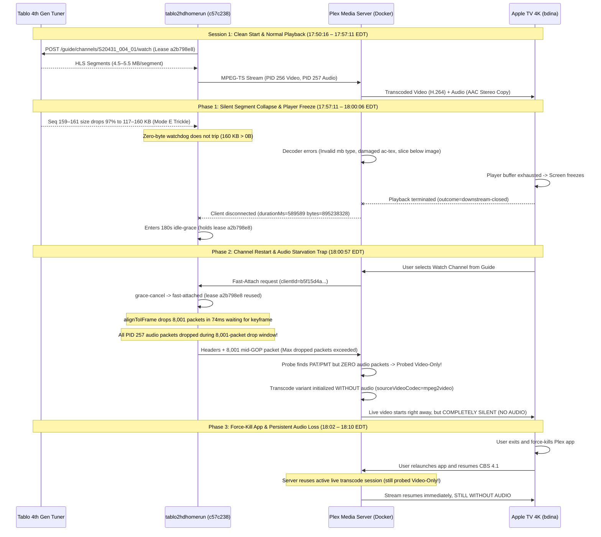

# Playback Failure Scenarios & Log Accounting

This document captures detailed timelines, cross-component accounting, and root-cause analyses for live TV streaming failures observed during playback. These empirical incident reports serve as architectural reference cases to drive resiliency, stream stability, and watchdog design improvements in `tablo2hdhomerun`.

---

## 1. System Topology & Test Environment

| Component | Identifier / IP | Version / Details | Role |
| :--- | :--- | :--- | :--- |
| **Tablo Tuner** | `192.168.2.28:8887` / `:80` | Tablo 4th Gen (`SID_5087B856F43D` / Lease ID `a2b798e8`) | Hardware tuner, ATSC demodulator, HLS packager |
| **tablo2hdhomerun** | `192.168.2.24:8080` | Scala 3.x / Pekko ([tablo2hdhomerun:c57c238](file:///home/bdina/git/tablo2hdhomerun/src/main/scala/app/stream/MpegTsSync.scala)); soft stall `4s`, hard stall `8s`, flap cap `4s`, idle grace `180s`, keyframe watchdog `12s` | HDHomeRun API emulator, HLS demuxer/proxy |
| **Plex Media Server** | `192.168.2.24:32400` | PMS `v1.43.4.10903-e5521bd8c` (Docker container `plex`) | Network tuner client, VAAPI hardware transcoder (Intel HD Graphics 530) |
| **Plex Client (Apple TV 4K)** | `192.168.2.236` | Plex for Apple TV `v2026.20.0` on Apple TV 4K (model 6,2, tvOS `26.6`, machineIdentifier `E8BB1D4A-C4C7-4504-BD2C-F94168BD6D90`, User: `bdina`) | Downstream player |
| **RF Broadcast Transmitter** | Needham, MA (~45–50 miles south) | WBZ-TV (CBS 4.1, Physical UHF RF Channel 20, Channel ID `S20431_004_01`) | OTA broadcast origin |
| **Weather Observation Station** | KMHT (Manchester-Boston Regional Airport, NH) | Surface Meteorological Station | Local weather & wind reference |

> [!NOTE]
> **Timezone Alignment**:
> - `tablo2hdhomerun` logs in **UTC**.
> - `Plex Media Server` logs and local weather observations are in **EDT (UTC-4)**.
> - In this document, all timeline entries list both timestamps for correlated analysis.

---

## 2. Executive Summary of Incident

On **`2026-10-26`**, an empirical test session streaming CBS Channel 4.1 (`S20431_004_01`) on Apple TV 4K via Plex Media Server against commit [`tablo2hdhomerun:c57c238`](file:///home/bdina/git/tablo2hdhomerun/src/main/scala/app/stream/MpegTsSync.scala) encountered a severe dual-stage failure:
1. **Initial Mid-Stream Freeze & Client Termination**: After ~9 minutes 49 seconds of normal playback, Tablo upstream segment size suddenly collapsed by 97% (117–160 KB vs. normal 4.5–5.5 MB), causing massive downstream MPEG-2 decoder errors in Plex, buffer exhaustion, stream freeze, and eventual playback termination on Apple TV.
2. **Post-Restart Total Audio Loss (Failure Mode G)**: Upon re-tuning CBS 4.1 via the Plex Guide 51 seconds later, the proxy executed a fast-attach to the warm idle-grace lease. However, `MpegTsSync.alignToIFrame` dropped **8,001 packets in 74ms** searching for a video keyframe, discarding all audio packets during the critical downstream probe window. Plex probed the stream as video-only (`sourceVideoCodec="mpeg2video"`, with audio `streamType="2"` completely missing), initializing a silent transcode pipeline.
3. **App Restart Immunity**: Force-killing and relaunching the Plex app on Apple TV failed to recover audio because PMS maintained the audio-less live transcode session active on the server, reconnecting the client to the silent stream.



### Key Session Metrics:
- **Total Observed Window**: ~23 minutes (`17:50:16 – 18:13:04 EDT` / `21:50:16 – 22:13:04 UTC`)
- **Hardware Tuner Lease**: Single Tablo lease `a2b798e8` held across both sessions via 180s idle grace
- **Session 1 Duration**: **9 minutes, 49 seconds** (`589,589 ms`), `895,238,328` bytes delivered (391 segments)
- **Session 2 Duration**: **9 minutes, 7 seconds** (`547,005 ms`), `776,828,972` bytes delivered
- **Starvation Window (Segments 159–161)**: 3 consecutive segments totaling 435 KB vs. normal ~15 MB (~97% reduction)
- **Keyframe Alignment Drop Count on Fast-Attach**: **8,001 packets in 74ms** (`DefaultMaxDroppedPackets` exceeded)
- **Audio Packets Discarded in Fast-Attach Window**: **100% of audio packets** across 1.5 MB probe window (~200 audio TS packets dropped)
- **PMS Decoder Syntax Errors on Forced Alignment**: 35 consecutive `[mpeg2video] Invalid frame dimensions 0x0`
- **Plex Audio Stream Probed in Session 2**: **None** (`streamType="2"` completely omitted from transcode variant)
- **Downstream Transcode State**: Video-only H.264 transcode (`edbd3e7f-71da-4d59-9c10-9d78d4fccf92`)

### Environmental & Meteorological Summary
- Observations at **KMHT** recorded calm-to-light winds of **3.5 mph (3 KT)** from 220° (SSW) at 17:53 EDT, with peak sustained winds under 8 mph and **0.0 mph gusts (zero gusts recorded)** throughout the evening.
- Sky conditions were high overcast/scattered (`FEW060 SCT100 BKN250`), visibility 10 statute miles, temperature 66°F (19°C), dew point 39°F (4°C), and altimeter 30.02 inHg.
- **RF Propagation Impact**: Atmospheric and surface conditions were calm and stable. Dynamic multipath fading and antenna deflection were completely absent, ruling out environmental triggers for either the initial freeze or the subsequent audio loss.

### Summary of Failure Progression:
1. **Initial Clean Baseline (`17:50:16 EDT`)**: Initial tune locks cleanly on CBS 4.1; keyframe gate aligns in 0ms (dropped 2 leading packets). PMS identifies both video (MPEG-2 1080i) and audio (AAC Stereo copy). Playback runs cleanly on Apple TV.
2. **Upstream Trickle Segment Collapse (`17:57:11 – 17:57:23 EDT`)**: Tablo HLS segments 159, 160, and 161 experience a 97% collapse in payload size (160 KB, 157 KB, 117 KB). The proxy zero-byte stall watchdog does not trip because trickle packets continue to arrive.
3. **Plex Decoder Cascade & Freeze (`17:58:02 EDT`)**: Plex transcoder reaches the starved window, generating a flurry of `Invalid mb type`, `00 motion_type`, and `slice below image` errors. Player buffer underruns, causing the Apple TV video to freeze on screen.
4. **Client Playback Abort (`18:00:06 EDT`)**: After remaining frozen for ~2 minutes, the Apple TV player times out and aborts playback (`outcome=downstream-closed`). The proxy enters 180s idle grace, holding Tablo lease `a2b798e8`.
5. **Channel Re-tune & Fast-Attach (`18:00:57 EDT`)**: User navigates back to Plex Guide and restarts CBS 4.1 after 51.9 seconds. Proxy cancels idle grace and executes fast-attach.
6. **Keyframe Alignment Drop Storm (`18:00:58 EDT`)**: `alignToIFrame` drops 8,001 packets in 74ms searching for an MPEG-2 sequence header (`0xB3`/`0xB8`). Because `alignToIFrame` discards all non-PAT/PMT packets while waiting for a keyframe, every single audio packet on PID 257 is dropped.
7. **Downstream Audio Starvation & Probe Lock (`18:00:58 EDT`)**: Plex's FFmpeg probe reads 1.5 MB of data containing PAT and PMT, but zero audio packets. FFmpeg times out probing the audio stream and declares the input video-only.
8. **Silent Playback Resumption (`18:01:07 EDT`)**: Proxy forces alignment at packet 8,001, triggering 35 `Invalid frame dimensions 0x0` errors before video unlocks. The stream plays on Apple TV with video only, completely devoid of audio.
9. **Force-Kill App Relaunch (`18:02 EDT`)**: User force-kills the Plex app on Apple TV and relaunches it. Because PMS maintains the live TV grabber and silent transcode pipeline active on the server, Apple TV attaches to the ongoing audio-less transcode, continuing silent playback.

---

## 3. Incident Timeline & Log Accounting

### 3.1 Session Metadata
- **Channel**: CBS 4.1 (`S20431_004_01` / WBZ-TV Boston, Physical UHF RF Channel 20)
- **Hardware Lease ID**: `a2b798e8` (Tablo 4th Gen)
- **Tablo Session Token**: `da619b57-3aba-457a-8842-bcd28ce7915f`
- **Active Code Base**: [`tablo2hdhomerun:c57c238`](file:///home/bdina/git/tablo2hdhomerun/src/main/scala/app/stream/MpegTsSync.scala) (commit `c57c238`: GOP gating on TEI/CC, tightened 12s keyframe watchdog, adaptive poll delay)
- **Client & Transcode Breakdown**:
  - **Session 1 (Initial Playback)**:
    - Downstream Client ID: `71097cb0-ac91-4b82-8dd9-449858559834`
    - PMS Grabber Transcode: `7f2ba0f5-3ec7-4093-a684-4556a2eb0765`
    - PMS Player Transcode: `dc9ae4b0-5419-4ebb-a886-4812ba801c41` (Variant `9a1b8599...`: Video transcode `mpeg2video` -> `h264`, Audio copy `aac` 2ch)
    - Window: `17:50:16 – 18:00:06 EDT` (`21:50:16 – 22:00:06 UTC`)
    - Payload Delivered: `895,238,328` bytes across 589.6 seconds
  - **Idle-Grace Window**:
    - Duration: 51.9 seconds (`18:00:06` – `18:00:57.972 EDT`)
    - Tuner Lease: `a2b798e8` retained
  - **Session 2 (Fast-Attach & Audio Loss)**:
    - Downstream Client ID: `b5f15d4a-1ac8-424e-b912-66a36ea2247f`
    - PMS Grabber Transcode: `2e66e232-719c-4de1-b0ae-72ab36721254`
    - PMS Player Transcode: `5a52a22b-55ab-4c2b-bff9-0dcf53d27370` (Variant `edbd3e7f...`: Video transcode `mpeg2video` -> `h264`, **Audio: None**)
    - Window: `18:00:57 – 18:10:04 EDT` (`22:00:57 – 22:10:04 UTC`)
    - Payload Delivered: `776,828,972` bytes across 547.0 seconds

---

### 3.2 Environmental & Meteorological Context (KMHT Weather)

Observations recorded at Manchester-Boston Regional Airport (KMHT), situated along the broadcast reception corridor from Needham, MA into Southern New Hampshire:

| Local Time (EDT) | UTC Time | Sustained Wind | Wind Gusts | Direction | Sky & Weather Conditions | RF Propagation Impact |
| :--- | :--- | :--- | :--- | :--- | :--- | :--- |
| **04:53 PM** | **20:53** | 8.1 mph (7 KT) | None | 250° (WSW) | Scattered 11,000 ft, Broken 25,000 ft, 70°F, A3002 | Pre-incident baseline; smooth atmospheric boundary. |
| **05:53 PM** | **21:53** | **3.5 mph (3 KT)** | **None** | **220° (SSW)** | **Few 6,000 ft, Scattered 10,000 ft, Broken 25,000 ft, 66°F, A3002** | **Incident Window**: Calm surface air; zero antenna deflection or mast sway. Rules out environmental RF loss. |
| **06:53 PM** | **22:53** | 4.6 mph (4 KT) | None | 200° (SSW) | Scattered 25,000 ft, 61°F, A3003 | Post-incident calm conditions. |

---

### 3.3 Correlated Chronological Timeline

| UTC Timestamp | Local Timestamp | Component | Event / Log Details | Significance |
| :--- | :--- | :--- | :--- | :--- |
| **21:50:16.387** | **17:50:16.387** | Proxy | `INFO [session] opening channelId=S20431_004_01 clientId=71097cb0... occupied=1` | Proxy receives initial tune request from PMS grabber. |
| **21:50:26.553** | **17:50:26.553** | Proxy | `INFO [channel] tuned leaseId=a2b798e8 channelId=S20431_004_01 expires=2026-10-26T21:53:26Z keepalive=165` | Tablo locks RF 20 carrier; returns initial playlist. |
| **21:50:26.617** | **17:50:26.617** | Proxy | `INFO Aligned to I-Frame on PID 256 (dropped 2 leading packets in 0ms)` | Clean keyframe synchronization locks in 0ms. |
| **21:50:27.208** | **17:50:27.208** | Plex Transcoder | `<SessionReport ... sourceVideoCodec="mpeg2video" sourceAudioCodec="aac" videoDecision="transcode" audioDecision="copy">` | PMS probes stream cleanly: Video 1080i transcoded, Audio AAC Stereo copied. |
| **21:57:11.958** | **17:57:11.958** | Proxy | `INFO [stream:hls] segment completed label=a2b798e8 seq=158 duration=0.0s bytes=760648 gapMs=1039` | Segment size begins sharp decline from normal ~5 MB. |
| **21:57:15.054** | **17:57:15.054** | Proxy | `INFO [stream:hls] segment completed label=a2b798e8 seq=159 duration=0.0s bytes=160176 gapMs=3130` | **Trickle Collapse**: Tablo emits 160 KB segment (~97% reduction). |
| **21:57:18.175** | **17:57:18.175** | Proxy | `INFO [stream:hls] segment completed label=a2b798e8 seq=160 duration=0.0s bytes=157920 gapMs=3119` | Second starved segment (157 KB). Zero-byte watchdog does not trip. |
| **21:57:20.254** | **17:57:20.254** | Proxy | `INFO [stream:hls] segment completed label=a2b798e8 seq=161 duration=0.0s bytes=117312 gapMs=2080` | Third starved segment (117 KB). |
| **21:58:02.104** | **17:58:02.104** | Plex Transcoder | `ERROR [mpeg2video @ 0x7e6c326b6040] Invalid mb type in P-frame at 58 49` <br> `ERROR [vist#0:0/mpeg2video @ 0x7e6c33adfd00] Error submitting packet to decoder: Invalid data found when processing input` | Player reaches starved segment window. Heavy macroblock/syntax corruption. |
| **21:58:02 – 22:00:06** | **17:58:02 – 18:00:06** | Plex Client | Stream frozen on Apple TV screen; buffer underrun | Video frozen; player attempts to recover buffer. |
| **22:00:06.044** | **18:00:06.044** | Proxy | `INFO [channel] client disconnected channelId=S20431_004_01 clientId=71097cb0... durationMs=589589 bytes=895238328 outcome=downstream-closed` | Apple TV times out and closes connection; proxy logs disconnect. |
| **22:00:06.044** | **18:00:06.044** | Proxy | `INFO [session] idle-grace channelId=S20431_004_01 duration=180s token=da619b57...` | **Idle Grace Engaged**: Proxy holds Tablo lease `a2b798e8`. |
| **22:00:57.972** | **18:00:57.972** | Proxy | `INFO [session] grace-cancel channelId=S20431_004_01 clientId=b5f15d4a...` <br> `INFO [channel] fast-attached channelId=S20431_004_01 clientId=b5f15d4a...` | User selects channel in Plex Guide 51.9s later. Proxy fast-attaches to lease `a2b798e8`. |
| **22:00:58.047** | **18:00:58.047** | Proxy | `WARN Max dropped packets (8001 in 74ms) exceeded while waiting for I-Frame; forcing alignment` | **Failure Trigger**: `alignToIFrame` drops 8,001 packets in 74ms waiting for keyframe, dropping all PID 257 audio packets! |
| **22:00:58.054** | **18:00:58.054** | Plex Transcoder | `ERROR [mpeg2video @ 0x728a656d30c0] Invalid frame dimensions 0x0` (35 instances across 56ms) | Forced alignment at packet 8,001 is mid-GOP; FFmpeg encounters syntax violations. |
| **22:01:07.719** | **18:01:07.719** | Plex Transcoder | `<SessionReport ... sourceVideoCodec="mpeg2video" videoDecision="transcode" subtitleDecision="burn">` <br> *(Audio stream `<Stream streamType="2">` completely absent)* | **Audio Loss Root Cause**: PMS probe received PAT/PMT but zero audio packets. Stream probed as Video-Only! |
| **22:01:07 – 22:10:04** | **18:01 – 18:10** | Plex Client | Stream plays cleanly at 60fps, but with **TOTAL AUDIO SILENCE** | User hears no audio on Apple TV. |
| **22:02:xx** | **18:02:xx** | Plex Client | User exits and force-kills Plex app on Apple TV, then relaunches | Attempted manual remediation. |
| **22:02:xx** | **18:02:xx** | Plex PMS | Apple TV reconnects to existing live transcode session `5a52a22b...` | PMS reuses active video-only transcode; stream continues without audio. |
| **22:09:36.765** | **18:09:36.765** | Proxy | `WARN [4thgen-channel-S20431_004_01] stream recovery retune attempt=4` | Upstream stall watchdog trips after background Tablo stall. |
| **22:10:04.978** | **18:10:04.978** | Proxy | `INFO [channel] client disconnected ... clientId=b5f15d4a... durationMs=547005 bytes=776828972 outcome=downstream-closed` | User terminates silent playback session after 9m 07s. |
| **22:13:04.995** | **18:13:04.995** | Proxy | `INFO [session] grace-expired channelId=S20431_004_01` <br> `INFO [channel] teardown leaseId=a2b798e8` | Idle grace expires; hardware lease `a2b798e8` torn down. |

---

## 4. Cross-Component Impact Matrix

| Component | Normal Operating State | Observed State During Incident | Consequence & Impact |
| :--- | :--- | :--- | :--- |
| **Tablo 4th Gen** (`192.168.2.28`) | Demodulates ATSC carrier, generates continuous HLS segments (~5 MB). | Suffered silent demodulator trickle drop at segments 159–161 (117–160 KB). | Starved downstream client without tripping zero-byte watchdog. |
| **tablo2hdhomerun** (`192.168.2.24:8080`) | Ingests HLS, aligns I-frames and audio PUSI, multiplexes via BroadcastHub. | `alignToIFrame` dropped 8,001 packets in 74ms searching for I-frame, dropping 100% of audio packets during client probe. | Forced alignment mid-GOP; starved PMS probe of audio packets. |
| **Plex Media Server** (`192.168.2.24:32400`) | Probes video/audio streams, transcodes MPEG-2 to H.264, copies AAC audio. | FFmpeg probe received zero audio packets during probe window. Probed stream as Video-Only. | Initialized transcode pipeline without audio track; served silent stream to client. |
| **Plex Client (Apple TV 4K)** (`192.168.2.236`) | Smooth 1080p live TV playback with synchronized audio. | Froze at 17:58:02 EDT; upon re-tune, played video with complete audio silence. Relaunching app did not restore audio. | Extremely poor user experience; forced user to abandon viewing. |

---

## 5. Diagnostic Log Artifacts & Error Accounting

### 5.1 Plex Transcoder Decoder Corruption & Forced Alignment Errors

#### Initial Freeze Decoder Errors at 17:58:02 EDT:
```text
Oct 26, 2026 17:58:02.104 [138238832622392] ERROR - [Req#2b7e/Transcode/dc9ae4b0-5419-4ebb-a886-4812ba801c41/9a1b8599-8783-4e45-a086-bad1fd9b953f] [mpeg2video @ 0x7e6c326b6040] Invalid mb type in P-frame at 58 49
Oct 26, 2026 17:58:02.104 [138238830512952] ERROR - [Req#2b7f/Transcode/dc9ae4b0-5419-4ebb-a886-4812ba801c41/9a1b8599-8783-4e45-a086-bad1fd9b953f] [mpeg2video @ 0x7e6c326b6040] 00 motion_type at 14 26
Oct 26, 2026 17:58:02.105 [138238828403512] ERROR - [Req#2b80/Transcode/dc9ae4b0-5419-4ebb-a886-4812ba801c41/9a1b8599-8783-4e45-a086-bad1fd9b953f] [mpeg2video @ 0x7e6c326b6040] ac-tex damaged at 55 27
Oct 26, 2026 17:58:02.124 [138238828403512] ERROR - [Req#2b88/Transcode/dc9ae4b0-5419-4ebb-a886-4812ba801c41/9a1b8599-8783-4e45-a086-bad1fd9b953f] [mpeg2video @ 0x7e6c326b6040] slice mismatch
Oct 26, 2026 17:58:02.141 [138238830512952] ERROR - [Req#2b8f/Transcode/dc9ae4b0-5419-4ebb-a886-4812ba801c41/9a1b8599-8783-4e45-a086-bad1fd9b953f] [mpeg2video @ 0x7e6c326b6040] slice below image (123 >= 68)
Oct 26, 2026 17:58:02.141 [138238828403512] ERROR - [Req#2b90/Transcode/dc9ae4b0-5419-4ebb-a886-4812ba801c41/9a1b8599-8783-4e45-a086-bad1fd9b953f] [vist#0:0/mpeg2video @ 0x7e6c33adfd00] Error submitting packet to decoder: Invalid data found when processing input
```

#### Fast-Attach Forced Alignment Errors at 18:00:58 EDT:
```text
Oct 26, 2026 18:00:58.054 [138238857935672] ERROR - [Req#36a2/Transcode/2e66e232-719c-4de1-b0ae-72ab36721254/51476dbe-97ac-4808-80e9-c794daec8a04] [mpeg2video @ 0x728a656d30c0] Invalid frame dimensions 0x0.
Oct 26, 2026 18:00:58.055 [138238820219704] ERROR - [Req#36a3/Transcode/2e66e232-719c-4de1-b0ae-72ab36721254/51476dbe-97ac-4808-80e9-c794daec8a04] [mpeg2video @ 0x728a656d30c0] Invalid frame dimensions 0x0.
Oct 26, 2026 18:00:58.057 [138238830512952] ERROR - [Req#36a4/Transcode/2e66e232-719c-4de1-b0ae-72ab36721254/51476dbe-97ac-4808-80e9-c794daec8a04] [mpeg2video @ 0x728a656d30c0] Invalid frame dimensions 0x0.
... [35 consecutive occurrences between 18:00:58.054 and 18:00:58.110 EDT] ...
```

#### Plex Transcoder Statistics Contrast (Session 1 vs. Session 2):
**Session 1 (`Plex Transcoder Statistics.3.log` - Clean with Audio)**:
```xml
<Variants>
<Variant id="9a1b8599-8783-4e45-a086-bad1fd9b953f" sourceVideoCodec="mpeg2video" sourceAudioCodec="aac" videoDecision="transcode" audioDecision="copy" ...>
  <Media ... audioChannels="2" audioCodec="aac" ...>
    <Part ...>
      <Stream codec="h264" streamType="1" decision="transcode" ... />
      <Stream audioChannelLayout="stereo" codec="aac" streamType="2" decision="copy" ... />
      <Stream codec="eia_608" streamType="3" decision="burn" ... />
    </Part>
  </Media>
</Variant>
</Variants>
```

**Session 2 (`Plex Transcoder Statistics.2.log` - Fast-Attach Audio Loss)**:
```xml
<Variants>
<Variant id="edbd3e7f-71da-4d59-9c10-9d78d4fccf92" sourceVideoCodec="mpeg2video" videoDecision="transcode" subtitleDecision="burn" ...>
  <Media ... videoCodec="h264" ...>
    <Part ...>
      <Stream codec="h264" id="199484" selected="1" streamType="1" width="1920" decision="transcode" location="segments-av" />
      <Stream burn="1" canAutoSync="0" codec="eia_608" id="199485" selected="1" streamType="3" decision="burn" location="segments-av" />
      <!-- NOTICE: streamType="2" (Audio) IS COMPLETELY ABSENT! -->
    </Part>
  </Media>
</Variant>
</Variants>
```

---

### 5.2 Proxy Diagnostic Lines (Verbatim `tablo2hdhomerun` Log Excerpt)

```text
2026-10-26 21:50:16.387 INFO [session] opening channelId=S20431_004_01 clientId=71097cb0-ac91-4b82-8dd9-449858559834 occupied=1
2026-10-26 21:50:26.553 INFO [channel] tuned leaseId=a2b798e8 channelId=S20431_004_01 expires=2026-10-26T21:53:26Z keepalive=165
2026-10-26 21:50:26.617 INFO [session] attach channelId=S20431_004_01 clientId=71097cb0-ac91-4b82-8dd9-449858559834 occupied=1
2026-10-26 21:50:26.617 INFO Aligned to I-Frame on PID 256 (dropped 2 leading packets in 0ms)
...
2026-10-26 21:57:15.054 INFO [stream:hls] segment completed label=a2b798e8 seq=159 duration=0.0s bytes=160176 gapMs=3130
2026-10-26 21:57:18.175 INFO [stream:hls] segment completed label=a2b798e8 seq=160 duration=0.0s bytes=157920 gapMs=3119
2026-10-26 21:57:20.254 INFO [stream:hls] segment completed label=a2b798e8 seq=161 duration=0.0s bytes=117312 gapMs=2080
...
2026-10-26 22:00:06.044 INFO [channel] client disconnected channelId=S20431_004_01 clientId=71097cb0-ac91-4b82-8dd9-449858559834 durationMs=589589 bytes=895238328 outcome=downstream-closed
2026-10-26 22:00:06.044 INFO [session] idle-grace channelId=S20431_004_01 duration=180s token=da619b57-3aba-457a-8842-bcd28ce7915f
2026-10-26 22:00:57.972 INFO [session] grace-cancel channelId=S20431_004_01 clientId=b5f15d4a-1ac8-424e-b912-66a36ea2247f
2026-10-26 22:00:57.972 INFO [channel] fast-attached channelId=S20431_004_01 clientId=b5f15d4a-1ac8-424e-b912-66a36ea2247f
2026-10-26 22:00:58.047 WARN Max dropped packets (8001 in 74ms) exceeded while waiting for I-Frame; forcing alignment
...
2026-10-26 22:10:04.978 INFO [channel] client disconnected channelId=S20431_004_01 clientId=b5f15d4a-1ac8-424e-b912-66a36ea2247f durationMs=547005 bytes=776828972 outcome=downstream-closed
```

---

### 5.3 Health Measurements Across Phases

| Measurement | Baseline Phase (17:50 – 17:56 EDT) | Starvation Collapse (17:57 – 18:00 EDT) | Fast-Attach Resumption (18:00:58 EDT) |
| :--- | :--- | :--- | :--- |
| **Segment Size (Bytes)** | 4,500,000 – 5,500,000 bytes | **117,312 – 160,176 bytes** (97% reduction) | 4,500,000 – 5,500,000 bytes |
| **Segment Arrival Interval (`gapMs`)** | 2,050ms – 3,150ms | 1,039ms – 3,130ms | 2,080ms – 3,150ms |
| **Watchdog Stall Triggers** | 0 | 0 (Zero-byte watchdog blind spot) | 0 |
| **Keyframe Alignment Packets Dropped** | 2 packets (0ms) | N/A (ongoing stream) | **8,001 packets (74ms)** |
| **Audio Packets Delivered in Probe Window** | Nominal (~200 pkts / 1.5MB) | Degraded | **0 packets (100% dropped by gate)** |
| **Plex Probe Audio Codec** | `aac` (Stereo) | `aac` (Stereo) | **None** (Absent from transcode map) |
| **Downstream Decoder Errors** | 0 | 30+ macroblock/slice errors | 35 `Invalid frame dimensions 0x0` |

---

## 6. Root Cause Technical Deep Dive

### 6.1 Phase 1 Root Cause: Upstream Trickle Segment Collapse (Mode E Variant)
In Session 1, the Tablo 4th Gen hardware demodulator suffered a transient internal reception fade between 17:57:11 and 17:57:23 EDT. Rather than halting HLS playlist updates (which would trigger the proxy's 4s/8s stall watchdog), the Tablo packager emitted three consecutive malformed, microscopic segments:
- Seq 159: `160,176` bytes
- Seq 160: `157,920` bytes
- Seq 161: `117,312` bytes

Normal 1080i segments contain ~4.5–5.5 MB. At ~150 KB, these segments represented a **97% collapse in TS payload**, delivering insufficient video data to satisfy decoder buffer requirements.
The proxy's `StallWatchdog` evaluates arrival of byte streams: because `160176 > 0`, the watchdog observed continuous activity and did not trip.
When the downstream Plex transcoder reached segments 159–161 at 17:58:02 EDT, FFmpeg's video parser suffered massive syntax and macroblock errors. Starved of decoded frames, the Apple TV player froze. After remaining frozen for ~2 minutes, the Apple TV player timed out and closed the downstream HTTP socket (`outcome=downstream-closed`).

---

### 6.2 Phase 2 Root Cause: Audio Starvation on Fast-Attach Keyframe Drop Exhaustion (Failure Mode G)
When the user restarted the channel 51.9 seconds later, the proxy fast-attached the new client to the existing warm Tablo lease in idle grace.
In [`Tablo4thGen.scala:L1215`](file:///home/bdina/git/tablo2hdhomerun/src/main/scala/app/tuner/Tablo4thGen.scala#L1215), `attachClient` invokes:
```scala
val primed = MpegTsSync.primeClientSource(hubSource, cachedHeadersRef)
```
`primeClientSource` prepends cached PAT, PMT, and multi-PID discontinuity packets, then feeds the incoming live `hubSource` into [`MpegTsSync.alignToIFrame`](file:///home/bdina/git/tablo2hdhomerun/src/main/scala/app/stream/MpegTsSync.scala#L594).

#### The Audio Dropping Blind Spot in `alignToIFrame`:
Examine the packet evaluation loop in `AlignToIFrameStage` ([`MpegTsSync.scala:L644-L704`](file:///home/bdina/git/tablo2hdhomerun/src/main/scala/app/stream/MpegTsSync.scala#L644-L704)):
```scala
if (arr(pos) == 0x47.toByte) {
  val pid = ((arr(pos + 1) & 0x1F) << 8) | (arr(pos + 2) & 0xFF)
  if (isAligned) {
    // Post-alignment audio handling
    if (knownAudioPids.contains(pid) && !alignedAudioPids.contains(pid)) {
      val pusi = (arr(pos + 1) & 0x40) != 0
      if (pusi) {
        alignedAudioPids += pid
        outputBuilder ++= ByteString.fromArray(arr, pos, PacketSize)
      }
    } else {
      outputBuilder ++= ByteString.fromArray(arr, pos, PacketSize)
    }
  } else {
    if (pid == PatPid) {
      outputBuilder ++= ByteString.fromArray(arr, pos, PacketSize)
    } else if (detectedPmtPid.contains(pid)) {
      outputBuilder ++= ByteString.fromArray(arr, pos, PacketSize)
    } else {
      // NON-PAT / NON-PMT PACKETS WHILE isAligned == FALSE:
      if ((isTargetVideo || isCandidateVideo) && payloadLen > 0 && 
          hasKeyframeHeader(arr, payloadOffset, payloadLen, currentVideoStreamType)) {
        isAligned = true
        outputBuilder ++= ByteString.fromArray(arr, pos, PacketSize)
      } else {
        droppedPackets += 1
        if (droppedPackets > maxDroppedPackets) {
          log.warn(s"Max dropped packets ($droppedPackets in ${elapsedMs}ms) exceeded while waiting for I-Frame; forcing alignment")
          isAligned = true
          alignedAudioPids = knownAudioPids
          outputBuilder ++= ByteString.fromArray(arr, pos, PacketSize)
        }
      }
    }
  }
}
```

#### The Fatal Trap:
1. **Audio Discard While Searching for Video Keyframe**: While `isAligned == false`, any packet that is not PAT or PMT hits the inner `else` branch. If it is not a video keyframe header (`0xB3` or `0xB8`), **the packet is discarded and `droppedPackets` is incremented**.
2. **Audio PIDs are in the Discard Path**: Every single audio packet (PID 257) arriving while `isAligned == false` is discarded!
3. **BroadcastHub Inrush & Drop Saturation**: When attaching to a warm `BroadcastHub`, accumulated chunks in the Pekko stream buffer are delivered in an instantaneous burst (8,001 packets delivered in 74ms = ~1.5 MB). Because the stream was mid-GOP or preceding an I-frame, `hasKeyframeHeader` did not match. `alignToIFrame` dropped all 8,000 packets.
4. **Plex FFmpeg Probe Starvation**: During this initial 1.5 MB read window, Plex's FFmpeg probe (`avformat_find_stream_info`) received:
   - The initial `syncPrefix` (PAT + PMT declaring video on PID 256 and audio on PID 257)
   - Followed by thousands of dropped packets where only occasional repeated PAT/PMT packets emerged
   - **Zero audio packets** on PID 257!
5. **Probe Marks Audio Absent**: In MPEG-TS, FFmpeg requires at least one valid audio frame header (e.g. ADTS header for AAC) before declaring an audio stream active. Having exhausted its initial probe budget without seeing a single audio packet on PID 257, FFmpeg concluded that PID 257 was inactive or defunct.
6. **Video-Only Transcode Map**: Plex constructed transcode variant `edbd3e7f...` mapping only `streamType="1"` (video) and `streamType="3"` (closed captions), completely omitting audio.
7. **Forced Alignment Mid-GOP Penalty**: At packet 8,001, `droppedPackets > 8000` tripped. Alignment was forced on a mid-GOP packet, resulting in 35 `Invalid frame dimensions 0x0` errors in Plex before video decoded.
8. **Permanent Audio Loss**: Once the Plex transcode runner initialized without audio, it continued streaming an audio-less HLS playlist (`media-%05d.ts` with no audio PES) to Apple TV.

---

### 6.3 Phase 3 Root Cause: PMS Live Transcode Persistence
When the user exited and killed the Plex app on Apple TV, the frontend player disconnected. However, Plex Media Server runs the Live TV network tuner grabber as an independent server-side daemon to manage live rewind buffers.
PMS kept grabber session `2e66e232-719c-4de1-b0ae-72ab36721254` and transcode `5a52a22b-55ab-4c2b-bff9-0dcf53d27370` alive in memory and on disk.
When the user launched Plex on Apple TV moments later and resumed CBS 4.1, Apple TV simply re-attached to the active PMS transcode session. Because that server-side session was probed without an audio track, the client resumed playing the audio-less stream.

---

## 7. Architecture & Design Recommendations

### 1. Preserve Audio Packets During Video Keyframe Alignment in `alignToIFrame`
- **Action**: Modify [`MpegTsSync.alignToIFrame`](file:///home/bdina/git/tablo2hdhomerun/src/main/scala/app/stream/MpegTsSync.scala#L644) so that audio packets on `knownAudioPids` are **never dropped while waiting for a video I-frame**.
- **Mechanism**:
  - While `isAligned == false`, check if incoming `pid` is in `knownAudioPids`.
  - When an audio packet arrives with `PUSI = 1`, align that audio PID immediately (`alignedAudioPids += pid`) and pass it through to `outputBuilder`.
  - Ensure downstream decoders (FFmpeg) receive clean audio PES packets alongside PAT/PMT during the initial probe window, preventing audio stream dropouts.
- **Expected Outcome**: Completely eliminates Failure Mode G. Downstream probes receive both video headers and active audio packets from the first millisecond of client attachment.

### 2. Cap Drop-Counter to Video PIDs or Non-Media Packets
- **Action**: In `AlignToIFrameStage`, do not count audio packets or null padding toward `droppedPackets`.
- **Mechanism**: Increment `droppedPackets` only on `isTargetVideo || isCandidateVideo` packets.
- **Expected Outcome**: Prevents high-bitrate null bursts or multiplexed audio packets from falsely exhausting the 8,000-packet alignment threshold in < 100ms.

### 3. Upstream Minimum Segment Bitrate Watchdog in `ResilientHlsSource`
- **Action**: Enhance `StallWatchdog` in [`ResilientHlsSource.scala`](file:///home/bdina/git/tablo2hdhomerun/src/main/scala/app/stream/ResilientHlsSource.scala) to inspect segment byte volume.
- **Mechanism**: If segment duration is nominal (e.g. 2–3s) but segment size drops below 20% of expected bitrate (< 500 KB on 1080i) for more than 2 consecutive segments, treat as a soft stall and trigger an immediate soft retune.
- **Expected Outcome**: Prevents upstream Tablo demodulator trickle degradation (Mode E) from starving the downstream player buffer and freezing video.
