# Playback Comparative Scenario & Empirical Analysis: Fringe Reception & Multi-Client Resilience

This document captures detailed timelines, cross-component accounting, and root-cause analyses for the side-by-side empirical live TV playback test conducted on the `all-day-tv` branch against commit [`tablo2hdhomerun:5259855`](file:///home/bdina/git/tablo2hdhomerun/src/main/scala/app/stream/MpegTsSync.scala). This test evaluated playback stability on **CBS 4.1** (a known fringe broadcast channel) concurrently comparing **Plex Media Server (via `tablo2hdhomerun`)** against the **official TabloTV application**.

---

## 1. System Topology & Test Environment

| Component | Identifier / IP | Version / Details | Role |
| :--- | :--- | :--- | :--- |
| **Tablo Tuner** | `192.168.2.28:8887` / `:80` | Tablo 4th Gen (`SID_5087B856F43D` / Leases `fc971df0`, `4e8d52c4`, `31a08c67`) | Hardware tuner, ATSC 1.0 demodulator, HLS packager |
| **tablo2hdhomerun** | `192.168.2.24:8080` | Scala 3.x / Pekko ([tablo2hdhomerun:5259855](file:///home/bdina/git/tablo2hdhomerun/src/main/scala/app/stream/MpegTsSync.scala)); 45s stall retention, 180s idle-grace, decoupled audio alignment, native STC timestamps | HDHomeRun API emulator, MPEG-TS demuxer & proxy |
| **Plex Media Server** | `192.168.2.24:32400` | PMS `v1.43.5.11079-b3b13e506` (Docker container `plex`) | Network tuner client, VAAPI hardware transcoder (Intel HD Graphics 530) |
| **Plex Client (Web / Chrome)** | `192.168.2.134` | Plex Web `v4.162.1` on Chrome 156 (macOS / `OSX`, machineIdentifier `oc4git1bo1g7ywh8kmzh6959`, session `88tjec4nibmifr6r5jzbo8hg`, User: `bdina`) | Primary test downstream player (DASH MP4) |
| **Official TabloTV Client** | `192.168.2.50` | Official TabloTV App on Apple iPad (model 7,3, iOS `17.7.11`, machineIdentifier `B9A0D6A9-1428-4C5C-9D93-4F69ED4983E4`) | Side-by-side benchmark player (direct native HLS) |
| **RF Broadcast Transmitter** | Needham, MA (~45–50 miles south) | WBZ-TV (CBS 4.1, Physical UHF RF Channel 20, Channel ID `S20431_004_01`) | Fringe OTA broadcast origin |
| **Weather Observation Station** | KMHT (Manchester-Boston Regional Airport, NH) | Surface Meteorological Station | Local weather & wind reference |

> [!NOTE]
> **Timezone Alignment**:
> - `tablo2hdhomerun` logs natively in **UTC**.
> - `Plex Media Server` logs and local weather observations are in **EDT (UTC-4)**.
> - All timeline entries below list both timestamps for correlated cross-component analysis.

---

## 2. Executive Summary of Test & Side-by-Side Comparison

### Scenario Classification
- **Classification**: **Mixed / Comparative Analysis**
- **Primary Objective**: Side-by-side comparison of Plex Media Server (via `tablo2hdhomerun`) vs official TabloTV app under fringe RF conditions.
- **Failure Mode**: Mode E (Fringe RF Error Storm & Transcoder A/V Desync; Hardware Wi-Fi Dropout)
- **Key Outcome**: Official app absorbed RF frames natively; Plex suffered transcode desync crash; validated 180s idle-grace fast-attaches (0ms, 183ms, 2.6s) and 43m stable continuous stream.
- **Validation Status**: Validated idle-grace recovery & identified transcode A/V desync sensitivity (`5259855`)

On **`2026-10-28`**, an empirical side-by-side test was conducted across the morning into midday (`10:25 – 12:13 EDT` / `14:25 – 16:13 UTC`) tuning **CBS Channel 4.1 (`S20431_004_01`)**, a known fringe UHF channel (Physical RF Channel 20, ~45–50 miles distance). The test directly compared downstream playback performance between **Plex Web (routed through `tablo2hdhomerun` and Plex Media Server's VAAPI transcode pipeline)** and the **official TabloTV application on iPad (consuming native HLS directly from the Tablo hardware)**.

### Key Incident Findings:

1. **Upstream Hardware Wi-Fi Dropout (~10:25–10:30 EDT)**:
   The Tablo 4th Gen hardware unexpectedly dropped off the local Wi-Fi network and became unreachable. Both the official TabloTV app and `tablo2hdhomerun` failed to communicate with the hardware (`initial tune failed after 60s recovery timeout`). Once Wi-Fi connectivity resumed at 10:27 EDT, carrier instability triggered 12 watchdog retunes before tearing down cleanly.

2. **Severe Fringe RF Corruption & Transcoder A/V Desync (~10:45–10:50 EDT)**:
   During lease `4e8d52c4`, fringe RF reception anomalies on UHF RF 20 introduced corrupted MPEG-2 TS packets into the stream.
   - **Official TabloTV App**: Handled the damaged frames natively via AVPlayer without crashing and maintained active playback.
   - **Plex Pipeline Failure**: PMS's VAAPI hardware transcoder (`Intel HD Graphics 530`) erupted into a catastrophic storm of **7,557 error lines** (`ac-tex damaged`, `00 motion_type`, `slice mismatch`, `Error submitting packet to decoder`), flooding logs so rapidly that PMS rotated its primary log file in seconds. The video decoder stalled and dropped damaged frames while audio decoded linearly, causing **audio to lag noticeably behind the video (Audio/Video desynchronization)**. At 10:50:25 EDT, the Plex Web client choked on the damaged DASH stream and crashed (`downstream-closed`).

3. **180-Second Idle-Grace Fast-Attach Success (~10:51 EDT)**:
   When Plex Web died at 10:50:25 EDT, `tablo2hdhomerun` entered `idle-grace` (180s), holding the upstream hardware lease `4e8d52c4` alive. When the user manually clicked re-tune in Plex at 10:51:39 EDT (74s later), the proxy canceled idle grace, attached the new client in **0 milliseconds**, aligned to the next clean I-frame on PID 256, and spawned a fresh PMS transcode runner—**immediately bringing the stream back up with audio perfectly in-sync**.

4. **Sustained 43-Minute Stable Stream & Downstream Disconnect (~10:51–11:38 EDT)**:
   The re-tuned session streamed continuously and flawlessly for **43 minutes, 3 seconds (`durationMs=2583370`)**, transferring **4.18+ GB** of data. At 11:34:42 EDT, the Plex client silently disconnected (`outcome=downstream-closed`). The proxy held idle grace for 180s until 11:37:42 EDT, when the lease expired. At 11:38 EDT, the user observed Plex had stopped while the official TabloTV app was still streaming.

5. **DASH Packaging Handshake Hang During Re-tune (~11:39–11:42 EDT)**:
   At 11:39:01 EDT, PMS requested a fresh tune (lease `31a08c67`). `tablo2hdhomerun` locked carrier and aligned in 132ms. PMS began transcoding 182 segments (181.4s), but the Plex Web player hung in an unattached loading state (`Player address="0.0.0.0"`, 0 playback reports). After 181 seconds, the initial tune attempt aborted. When the user retried at 11:42:45 EDT, `tablo2hdhomerun` fast-attached the client from idle grace in **183ms**, and playback immediately started.

6. **Server-Side Inactive Pause Timeout (~11:59–12:04 EDT)**:
   Playback was paused in Plex Web around 11:59 EDT. After sitting paused for ~5 minutes, PMS reaped the inactive transcode session at 12:03:46 EDT (`durationMs=1260815` = 21m total), terminating the session. The official TabloTV app, lacking server-side transcode reaping, remained running.

7. **Final Playback Abort & Clean Teardown (~12:04–12:13 EDT)**:
   A manual unpause/re-tune at 12:04:24 EDT fast-attached from idle grace in 2.6s, streaming 341 segments (5m 41s). Playback failed downstream again at 12:10:14 EDT, terminating the test. `tablo2hdhomerun` held idle grace for 180s and tore down cleanly at 12:13:14 EDT.

---

```mermaid
sequenceDiagram
    participant Tablo as Tablo 4th Gen (192.168.2.28)
    participant Proxy as tablo2hdhomerun (5259855)
    participant PMS as Plex Media Server (Docker)
    participant PlexClient as Plex Web (192.168.2.134)
    participant TabloApp as TabloTV iPad App (192.168.2.50)

    Note over Tablo,TabloApp: Phase 1: Hardware Wi-Fi Dropout (10:25 – 10:30 EDT)
    Tablo--xProxy: Wi-Fi Unreachable / HTTP 8887 Timeout (60s recovery)
    Tablo--xTabloApp: Device Offline on Wi-Fi Network
    Note over Tablo,Proxy: Wi-Fi recovers at 10:27; demodulator flaps; 12 retunes before teardown

    Note over Tablo,TabloApp: Phase 2: Fringe RF Corruption & A/V Desync (10:45 – 10:50 EDT)
    PlexClient->>PMS: Tune CBS 4.1
    PMS->>Proxy: POST /auto/v4.1
    Proxy->>Tablo: /guide/channels/.../watch (Lease 4e8d52c4)
    Tablo-->>Proxy: Fringe HLS Segments with Damaged RF Slices
    Proxy->>PMS: Sanitized MPEG-TS (Video PID 256, Audio PID 257)
    Tablo-->>TabloApp: Direct HLS: AVPlayer conceals damaged frames (Playback OK)
    PMS->>PMS: VAAPI Transcoder hit with 7,557 error lines!
    Note over PMS,PlexClient: Video decoder stalls/drops frames; audio runs linear -> Audio Lags Behind Video!
    PlexClient--xPMS: Player crashes on corrupt DASH stream (10:50:25 EDT)
    Proxy->>Proxy: Enters 180s idle-grace (Lease 4e8d52c4 retained)

    Note over Tablo,TabloApp: Phase 3: Instant Fast-Attach & 43m Uptime (10:51 – 11:38 EDT)
    PlexClient->>PMS: Manual Re-tune (10:51:39 EDT)
    PMS->>Proxy: POST /auto/v4.1
    Note over Proxy: Canceled idle-grace; attached in 0ms; aligned to I-frame
    PMS->>PlexClient: Clean transcode spawned -> Perfect A/V Sync Restored!
    Note over PMS,PlexClient: Continuous playback for 43m 3s (4.18 GB transferred)
    PlexClient--xPMS: Downstream client closes connection (11:34:42 EDT)
    Proxy->>Proxy: Enters idle-grace; expires at 11:37:42 EDT; teardown 4e8d52c4
    Note over PlexClient: User notices Plex stopped at 11:38 EDT (TabloTV app still running)

    Note over Tablo,TabloApp: Phase 4: Re-Tune Hang vs Fast-Attach Rescue (11:39 – 11:43 EDT)
    PMS->>Proxy: New Tune (Lease 31a08c67)
    PMS->>PMS: Transcoder generates 182 segments, but Plex Web hangs unattached
    PMS--xProxy: Client times out after 181s (11:42:02 EDT)
    Proxy->>Proxy: Enters idle-grace
    PlexClient->>PMS: Retry Re-tune (11:42:45 EDT)
    Note over Proxy: Fast-attached in 183ms; DASH transcode initializes and plays!

    Note over Tablo,TabloApp: Phase 5: Inactive Pause Timeout & Termination (11:59 – 12:13 EDT)
    PlexClient->>PlexClient: Paused at ~11:59 EDT (TabloTV app continues live)
    PMS--xProxy: Inactive transcode reaped at 12:03:46 EDT (Session ended)
    PlexClient->>Proxy: Unpause / re-tune at 12:04:24 EDT (Attached in 2.6s)
    PlexClient--xPMS: Playback fails at 12:10:14 EDT; user terminates test
    Proxy->>Proxy: Idle-grace expires at 12:13:14 EDT; clean teardown 31a08c67
```

---

### Key Session Metrics:

- **Total Test Window**: **1 hour, 47 minutes, 49 seconds** (`10:25:25 – 12:13:14 EDT` / `14:25:25 – 16:13:14 UTC`)
- **Hardware Tuner Leases**:
  - `fc971df0`: Held during Tablo recovery flap (`10:27:59 – 10:41:35 EDT`), 280 segments (1.01 GB), 12 watchdog retunes.
  - `4e8d52c4`: Held for 52m 30s (`10:45:12 – 11:37:42 EDT`), 1,289 segments (4.72 GB), 0 retunes, rescued via idle grace in 0ms.
  - `31a08c67`: Held for 34m 13s (`11:39:01 – 12:13:14 EDT`), 798 segments (3.03 GB), 0 retunes, rescued via idle grace twice.
- **Proxy Stream Throughput**: **2,367 HLS segments** delivered, **9,404,849,648 bytes (~9.40 GB)** transferred.
- **Plex Downstream Playback Segments Delivered**:
  - Session 1 (Failed / Desync): 313s duration, 7,557 decoder errors.
  - Session 2 (Continuous): **43 minutes, 3 seconds (`2,583,370 ms`)**, 4.18+ GB transferred.
  - Session 3 (Loading Hang): 182 transcode segments generated, 0 playback reports, timed out after 181s.
  - Session 4 (Post-Hang Playback): **20 minutes, 33 seconds** (1,233 DASH segments), paused at ~11:59 EDT.
  - Session 5 (Post-Pause Playback): 341 segments (5m 41s) before final downstream failure.
- **Transcoder Decode Errors**:
  - Session 1: **7,557 error lines** during fringe RF packet burst (induced A/V desync and player crash).
  - Subsequent Sessions: 27 errors in Session 2, 10 errors in Session 4, 0 errors in Session 5.
- **Idle-Grace Fast-Attaches**: **3 successful re-attaches** (0ms at 10:51, 183ms at 11:42, 2.6s at 12:04), preserving tuner locks.

---

### Environmental & Meteorological Summary

Observations recorded at **KMHT** (Manchester-Boston Regional Airport, NH), situated along the transmission corridor for Boston OTA broadcasts into Southern New Hampshire:

- **Wind & Surface Air**: Calm to light breeze (**3.5–8.1 mph**) predominantly shifting from NNW (340°) to SSW (210°). **Zero gusts (0.0 mph)** were recorded throughout the entire test period.
- **Atmospheric & Sky Conditions**: Altimeter steady at high pressure (**30.45 – 30.51 inHg** / 1031–1033 hPa), visibility 10 statute miles, sky cover transitioning from scattered high cirrus (`SCT150 BKN200`) to clear (`CLR`). Surface temperature warmed from 39°F (4°C) to 52°F (11°C).
- **RF Propagation Impact**: The complete absence of wind gusts confirms that mechanical antenna mast deflection and tree canopy flutter were **not** factors in this incident. The RF anomalies observed on CBS 4.1 (UHF RF 20) were driven by morning boundary-layer thermal transition across the ~45–50 mile fringe reception path, interacting with Tablo's internal hardware Wi-Fi dropout and ATSC 1.0 8VSB demodulator tracking.

---

## 3. Incident Timeline & Log Accounting

### 3.1 Session Metadata

- **Channel**: CBS 4.1 (`S20431_004_01` / WBZ-TV Boston, Physical UHF RF Channel 20)
- **Active Code Base**: [`tablo2hdhomerun:5259855`](file:///home/bdina/git/tablo2hdhomerun/src/main/scala/app/stream/MpegTsSync.scala) on branch `all-day-tv`
- **Clients**:
  - **Client A (Plex Web)**: Chrome 156 on macOS (`OSX`), IP `192.168.2.134`, machineIdentifier `oc4git1bo1g7ywh8kmzh6959`, session `88tjec4nibmifr6r5jzbo8hg`, User `bdina`.
  - **Client B (TabloTV App)**: iPad, IP `192.168.2.50`, machineIdentifier `B9A0D6A9-1428-4C5C-9D93-4F69ED4983E4`.
- **PMS Transcoder Profile**: Intel HD Graphics 530 (VAAPI), H.264 1080p transcode, AAC Stereo audio.

---

### 3.2 Environmental & Meteorological Context (KMHT Weather)

| Local Time (EDT) | UTC Time | Sustained Wind | Wind Gusts | Direction | Sky & Weather Conditions | RF Propagation Impact |
| :--- | :--- | :--- | :--- | :--- | :--- | :--- |
| **09:53 AM** | **13:53** | 3.5 mph (3 KT) | None | 340° (NNW) | Broken 20,000 ft (`BKN200`), 39°F (4°C), A3051 | Pre-test baseline; light surface air; high pressure. |
| **10:53 AM** | **14:53** | 3.5 mph (3 KT) | None | Variable (`VRB`) | Scattered 15,000 ft (`SCT150 BKN200`), 45°F (7°C), A3049 | Calm; boundary layer warming; fringe RF multipath flutter. |
| **11:53 AM** | **15:53** | 3.5 mph (3 KT) | None | Variable (`VRB`) | Scattered 15,000 ft (`SCT150 BKN200`), 46°F (8°C), A3049 | Calm; thermal boundary heating across fringe path. |
| **12:53 PM** | **16:53** | 8.1 mph (7 KT) | None | 210° (SSW) | Clear (`CLR`), 52°F (11°C), A3045 | Post-test wind shift; light breeze; zero gusts. |

---

### 3.3 Correlated Chronological Timeline

| UTC Timestamp | Local Timestamp | Component | Event / Log Details | Significance |
| :--- | :--- | :--- | :--- | :--- |
| **14:25:25.428** | **10:25:25.428** | Proxy | `INFO [session] opening channelId=S20431_004_01 clientId=ee31f615... occupied=1` | Tune initiated for CBS 4.1. |
| **14:25:51.297** | **10:25:51.297** | Proxy | `INFO [session] opening cancelled channelId=S20431_004_01 all waiters released` | Tablo hardware unresponsive on network; HTTP request hangs. |
| **14:26:32.065** | **10:26:32.065** | Proxy | `WARN [4thgen-channel] initial tune failed after 60s recovery timeout channelId=S20431_004_01` | **Tablo Offline**: Hardware completely dropped off Wi-Fi network; official app also unreachable. |
| **14:27:59.873** | **10:27:59.873** | Proxy | `INFO [session] opening channelId=S20431_004_01 clientId=e2b82419... occupied=1` | Tablo reconnects to Wi-Fi; tune retry succeeds. |
| **14:27:59.939** | **10:27:59.939** | Proxy | `INFO [channel] tuned leaseId=fc971df0 channelId=S20431_004_01 expires=2026-10-28T14:30:59Z keepalive=165` | Hardware tuner lease `fc971df0` acquired. |
| **14:32:00.997** | **10:32:00.997** | Proxy | `WARN [4thgen-channel-S20431_004_01] no new data for 8s, retuning` | Post-reconnect carrier flap; demodulator stalls. |
| **14:32:02 – 14:40:21** | **10:32 – 10:40** | Proxy | `WARN [4thgen-channel-S20431_004_01] stream recovery retune attempt=2 ... 12` | Proxy executes 12 retunes attempting to stabilize flapping carrier. |
| **14:41:35.897** | **10:41:35.897** | Proxy | `INFO [session] grace-expired channelId=S20431_004_01` <br> `INFO [channel] teardown leaseId=fc971df0` | Idle grace expires; degraded lease cleanly torn down. |
| **14:45:12.516** | **10:45:12.516** | Proxy | `INFO [session] opening channelId=S20431_004_01 clientId=fa3a8334... occupied=1` | User launches fresh tune from Plex Web. |
| **14:45:12.582** | **10:45:12.582** | Proxy | `INFO [channel] tuned leaseId=4e8d52c4 channelId=S20431_004_01 expires=2026-10-28T14:48:12Z keepalive=165` | New hardware lease `4e8d52c4` locked cleanly. |
| **14:45:12.645** | **10:45:12.645** | Proxy | `INFO Aligned to I-Frame on PID 256 (dropped 1 leading packets in 62ms)` | Clean keyframe alignment in 62ms. |
| **14:45:36 – 14:49:21** | **10:45 – 10:49** | Plex Transcoder | `ERROR [mpeg2video @ 0x7610390b56c0] 00 motion_type at 107 17` <br> `ERROR [mpeg2video] ac-tex damaged` <br> `ERROR [mpeg2video] slice mismatch` (7,557 error lines) | **RF Packet Error Storm**: Fringe RF corruption hits VAAPI video decoder. |
| **14:49:21.278** | **10:49:21.278** | Plex PMS | `INFO - Plex Media Server v1.43.5... [Log rotated at 10 MB due to error storm]` | PMS primary log saturates and rotates within seconds. |
| **14:49:21 – 14:50:25** | **10:49 – 10:50** | Plex Client / Tablo App | **User Note**: Audio in Plex lags behind video; official TabloTV app stays normal | **A/V Desync Observed**: Video decoder dropped corrupt frames while audio clock ran linear; TabloTV app concealed errors natively. |
| **14:50:25.907** | **10:50:25.907** | Proxy | `INFO [channel] client disconnected ... durationMs=313389 outcome=downstream-closed` | **Plex Web Dies**: Chrome DASH player aborts playback on corrupt stream. |
| **14:50:25.907** | **10:50:25.907** | Proxy | `INFO [session] idle-grace channelId=S20431_004_01 duration=180s token=a14142d4...` | **Idle-Grace Activated**: Proxy holds lease `4e8d52c4` open for 180s. |
| **14:51:39.556** | **10:51:39.556** | Proxy | `INFO [session] grace-cancel channelId=S20431_004_01 clientId=a9a31f53...` <br> `INFO [session] attach ... occupied=1` | **Fast-Attach Rescue**: User re-tunes in Plex; proxy attaches new client in **0ms** without re-tuning Tablo. |
| **14:51:39.556** | **10:51:39.556** | Proxy | `INFO Aligned to I-Frame on PID 256 (dropped 17 leading packets in 0ms)` | Clean keyframe gate resets downstream decoder; **A/V sync restored immediately**! |
| **14:51:39 – 15:34:42** | **10:51 – 11:34** | Proxy / Plex | Continuous streaming: 1,000+ segments, **4.18+ GB transferred**, smooth playback | Long-duration stability confirmed across 43m 3s of continuous viewing. |
| **15:34:42.926** | **11:34:42.926** | Proxy | `INFO [channel] client disconnected ... durationMs=2583370 bytes=4185792928 outcome=downstream-closed` | Downstream Plex transcoder/client silently closes stream. |
| **15:34:42.926** | **11:34:42.926** | Proxy | `INFO [session] idle-grace channelId=S20431_004_01 duration=180s token=a14142d4...` | Proxy enters 180s idle-grace. |
| **15:37:42.947** | **11:37:42.947** | Proxy | `INFO [session] grace-expired channelId=S20431_004_01` <br> `INFO [channel] teardown leaseId=4e8d52c4` | Idle-grace expires without client attach; lease `4e8d52c4` torn down. |
| **15:38:00** | **11:38:00** | Plex Client / Tablo App | **User Note**: Plex noticed stopped; official TabloTV app still running | User discovers Plex playback has stopped while TabloTV app continued streaming. |
| **15:39:01.416** | **11:39:01.416** | Proxy | `INFO [session] opening channelId=S20431_004_01 clientId=f253b6e7... occupied=1` | User triggers re-tune in Plex Web. |
| **15:39:01.537** | **11:39:01.537** | Proxy | `INFO [channel] tuned leaseId=31a08c67 channelId=S20431_004_01 expires=2026-10-28T15:42:01Z keepalive=165` | New hardware lease `31a08c67` acquired. |
| **15:39:01.670** | **11:39:01.670** | Proxy | `INFO Aligned to I-Frame on PID 256 (dropped 2 leading packets in 132ms)` | Keyframe aligned cleanly. |
| **15:39:01 – 15:42:02** | **11:39 – 11:42** | Plex PMS | `<SessionReport ... transcode="75e1a1cc..." session="88tjec4nibmifr6r5j..."> <Player address="0.0.0.0" ... />` (182 segments generated; 0 playback reports) | **DASH Handshake Hang**: PMS transcode runs, but Plex Web player hangs loading and never ingests fragments. |
| **15:42:02.877** | **11:42:02.877** | Proxy | `INFO [channel] client disconnected ... durationMs=181399 bytes=293581552 outcome=downstream-closed` | **Tune Failure**: After 181s (3 min) hanging, Plex closes connection; user observes tune failure. |
| **15:42:02.877** | **11:42:02.877** | Proxy | `INFO [session] idle-grace channelId=S20431_004_01 duration=180s token=2918324e...` | Proxy retains lease `31a08c67` in idle grace. |
| **15:42:45.252** | **11:42:45.252** | Proxy | `INFO [session] grace-cancel channelId=S20431_004_01 clientId=c39fe950...` <br> `INFO [channel] fast-attached channelId=S20431_004_01` | **Fast-Attach Rescue #2**: User immediately retries; proxy fast-attaches in **183ms**. |
| **15:43:05.538** | **11:43:05.538** | Plex PMS | `<SessionReport ... transcode="68itzlpzm1yts4wx02p0cptn" session="88tjec4nibmifr6r5j..."> <Player address="192.168.2.134" ... />` | Fresh DASH transcode session attaches; playback immediately starts in Chrome! |
| **15:43:05 – 16:03:46** | **11:43 – 12:03** | Plex PMS / Web | 1,233 segments (20m 33s) generated; user pauses playback at ~11:59 EDT | Stream plays smoothly until user pauses; transcode idles. |
| **16:03:46.067** | **12:03:46.067** | Proxy | `INFO [channel] client disconnected ... durationMs=1260815 outcome=downstream-closed` | **Pause Inactive Timeout**: PMS reaps paused transcode session after ~5 min idle; Plex session ends. |
| **16:03:46.067** | **12:03:46.067** | Proxy | `INFO [session] idle-grace channelId=S20431_004_01 duration=180s token=2918324e...` | Proxy enters 180s idle-grace. |
| **16:04:24.444** | **12:04:24.444** | Proxy | `INFO [session] grace-cancel channelId=S20431_004_01 clientId=c5dee2a0...` <br> `INFO Aligned to I-Frame on PID 256 (dropped 43 leading packets in 2613ms)` | **Fast-Attach Rescue #3**: User unpauses/retunes in Plex; proxy fast-attaches in 2.6s. |
| **16:04:27 – 16:10:14** | **12:04 – 12:10** | Plex PMS | Transcode `pfuwzvqs5okpc4pp9tv21iaj`: 341 segments (5m 41s) delivered | Playback resumes and streams normally. |
| **16:10:14.089** | **12:10:14.089** | Proxy | `INFO [channel] client disconnected ... durationMs=349645 outcome=downstream-closed` | Downstream playback fails again; user terminates test. |
| **16:10:14.089** | **12:10:14.089** | Proxy | `INFO [session] idle-grace channelId=S20431_004_01 duration=180s token=2918324e...` | Proxy enters idle-grace. |
| **16:13:14.106** | **12:13:14.106** | Proxy | `INFO [session] grace-expired channelId=S20431_004_01` <br> `INFO [channel] teardown leaseId=31a08c67` <br> `INFO [session] removed channelId=S20431_004_01 occupied=0` | Idle-grace expires; clean teardown of lease `31a08c67`; test officially concludes. |

---

## 4. Cross-Component Impact Matrix

| Component | Normal Operating State | Observed State During Incident | Consequence & Impact |
| :--- | :--- | :--- | :--- |
| **Tablo 4th Gen** (`192.168.2.28`) | Continuous demodulation and clean HLS generation. | Dropped off local Wi-Fi around 10:25 EDT; carrier flapped after recovery. Emitted corrupted MPEG-2 TS packets under fringe RF fading on RF 20. | Hardware network drop halted all clients; RF packet corruption triggered downstream decode cascades. |
| **tablo2hdhomerun** (`192.168.2.24:8080`) | Sanitizes TS packets, aligns I-frames, and serves MPEG-TS stream to clients. | 180s idle-grace retained leases through client disconnects; fast-attached clients in 0–183ms; aligned to I-frames cleanly without whole-GOP drops. | **High Resiliency**: Prevented needless hardware retunes and lease recreation during client crashes and pauses. |
| **Plex Media Server** (`192.168.2.24:32400`) | VAAPI transcode pipeline smoothly converts MPEG-2 to H.264 DASH. | Hit with **7,557 error lines** during RF packet corruption; video decoder dropped frames while audio continued, causing A/V desync; reaped paused transcode after 5 min. | Vulnerable to upstream bit errors; transcode desync and inactive pause timeout degraded viewing experience. |
| **Plex Web Client** (`192.168.2.134`) | Steady 60fps playback via MSE DASH. | Suffered noticeable audio lag at 10:49 EDT; crashed at 10:50 EDT; hung loading for 181s at 11:39 EDT; session terminated on pause at 12:03 EDT. | Multiple interruptions requiring manual re-tuning. |
| **Official TabloTV App** (`192.168.2.50`) | Direct HLS streaming via AVPlayer on iPad. | Went offline at 10:25–10:30 EDT when hardware dropped Wi-Fi; maintained uninterrupted playback through fringe RF errors, pause intervals, and Plex retunes. | Superior error concealment and client-side clock resynchronization on fringe channels. |

---

## 5. In-Depth Comparative & Technical Analysis

### 5.1 Why TabloTV Handled Fringe RF Better Than Plex

A critical finding from this test is the divergence in behavior between the **official TabloTV app** and the **Plex pipeline** when subjected to identical fringe RF packet corruption on CBS 4.1:

```mermaid
flowchart TD
    subgraph TabloTV_Path["Official TabloTV App (Direct Native Path)"]
        A1["Tablo 4th Gen Tuner"] -->|"HLS Segments (.ts)"| B1["iPad AVPlayer / ExoPlayer"]
        B1 -->|"Direct HW MPEG-2 Decode & Concealment"| C1["Screen / Audio Output"]
        C1 -->|"AVPlayer drops corrupt slices & resyncs clock"| D1["Continuous Playback (Zero Crashes)"]
    end

    subgraph Plex_Path["Plex + tablo2hdhomerun Path (Multi-Tier Transcode)"]
        A2["Tablo 4th Gen Tuner"] -->|"HLS Segments (.ts)"| B2["tablo2hdhomerun Proxy"]
        B2 -->|"MPEG-TS Stream (/auto/v4.1)"| C2["Plex Media Server (FFmpeg VAAPI)"]
        C2 -->|"MPEG-2 Video HW Decode (7,557 Errors)"| D2["VAAPI Decode Stall / Frame Drops"]
        C2 -->|"AAC Audio Decode (Linear Clock)"| E2["Audio Clock Unadjusted"]
        D2 & E2 -->|"Mux into DASH MP4 Fragments"| F2["Audio Lags Behind Video (A/V Desync)"]
        F2 -->|"Plex Web (Chrome MSE)"| G2["Player Abort / Crash (downstream-closed)"]
    end
```



1. **Pipeline Depth & Transcoding Sensitivity**:
   - **TabloTV App**: Directly ingests native HLS. The player uses native platform decoders (Apple AVPlayer on iOS), which are purpose-built to tolerate transmission bit errors in broadcast streams. Damaged macroblocks are concealed or skipped without altering the master playback presentation clock.
   - **Plex Media Server**: Implements a multi-stage transcoding architecture:
     $$\text{Tablo HLS} \xrightarrow{\text{proxy}} \text{MPEG-TS} \xrightarrow{\text{PMS Ingest}} \text{FFmpeg Demux} \xrightarrow{\text{VAAPI Decode}} \text{VAAPI Encode (H.264)} \xrightarrow{\text{DASH MP4 Mux}} \text{Chrome MSE}$$
     Any bit damage passing into FFmpeg's `mpeg2video` decoder generates macroblock errors (`00 motion_type`, `slice mismatch`, `ac-tex damaged`).

2. **The Mechanism of Audio/Video Desynchronization**:
   At 10:49 EDT, the VAAPI hardware decoder encountered **7,557 error lines** within seconds. When FFmpeg's video decoding thread encounters severe slice corruption:
   - Corrupted video frames fail decoding and are discarded (`Error submitting packet to decoder`).
   - The video presentation clock either stutters, drops frames, or leaps forward to the next clean slice.
   - Meanwhile, the audio decoding thread (handling stereo AAC packets on PID 257) processes undamaged audio frames without interruption.
   - In Plex's DASH MP4 muxer, this disparity results in video frames displaying ahead of the delayed audio timestamps, producing the distinct user symptom where **audio lags noticeably behind the video**.

3. **Player Crash via DASH Fragment Invalidation**:
   As corrupted video slices were packaged into DASH MP4 fragments, fragmented MP4 box boundaries and sample tables became invalid. At 10:50:25 EDT, the Chrome MediaSource Extensions (MSE) pipeline rejected the incoming media segment, causing Plex Web to abort playback and close the downstream connection (`outcome=downstream-closed`).

---

### 5.2 The Crucial Role of 180s Idle-Grace Fast-Attach

The standout success of `tablo2hdhomerun` in this test was the **180-second `idle-grace` mechanism**:

1. **Recovery at 10:51:39 EDT (0ms Attach)**:
   When Plex Web crashed at 10:50:25 EDT, `tablo2hdhomerun` did **not** immediately tear down lease `4e8d52c4`. Instead, it transitioned to `idle-grace duration=180s`. When the user manually re-tuned 74 seconds later:
   ```text
   2026-10-28 14:51:39.556 INFO [session] grace-cancel channelId=S20431_004_01 clientId=a9a31f53-4953-4260-b63f-99fe5ea80c3b
   2026-10-28 14:51:39.556 INFO [session] attach channelId=S20431_004_01 clientId=a9a31f53-4953-4260-b63f-99fe5ea80c3b occupied=1
   2026-10-28 14:51:39.556 INFO Aligned to I-Frame on PID 256 (dropped 17 leading packets in 0ms)
   ```
   The client attached in **0ms**, received an immediate clean I-frame gate on PID 256, and spawned a fresh PMS transcode session with reset audio/video buffers—**restoring locked A/V sync instantly without dropping the tuner**.

2. **Recovery at 11:42:45 EDT (183ms Attach)**:
   When the previous re-tune hung on DASH packaging and aborted after 181s, the proxy held lease `31a08c67` in idle grace. The user's retry 43 seconds later attached in **183ms**, bypassing the ~10s hardware tuning latency and immediately restoring live playback.

3. **Recovery at 12:04:24 EDT (2.6s Attach)**:
   When PMS killed the paused session after ~5 minutes of inactivity, idle grace held the lease. The user unpaused 38 seconds later and was fast-attached in **2.6s**.

---

### 5.3 Diagnostic Log Artifacts & Accounting

#### 1. Transcoder Error Burst Inducing A/V Desync (10:49:21 EDT):
```text
Oct 28, 2026 10:49:21.093 ERROR - [Req#1138a2/Transcode/.../eda451cd...] [mpeg2video @ 0x7610390b56c0] Warning MVs not available
Oct 28, 2026 10:49:21.131 ERROR - [Req#1138a3/Transcode/.../eda451cd...] [mpeg2video @ 0x7610390b56c0] 00 motion_type at 49 14
Oct 28, 2026 10:49:21.131 ERROR - [Req#1138a4/Transcode/.../eda451cd...] [mpeg2video @ 0x7610390b56c0] ac-tex damaged at 28 65
Oct 28, 2026 10:49:21.185 ERROR - [Req#1138ac/Transcode/.../eda451cd...] [mpeg2video @ 0x7610390b56c0] slice mismatch
Oct 28, 2026 10:49:21.237 ERROR - [Req#1138b4/Transcode/.../eda451cd...] [mpeg2video @ 0x7610390b56c0] mb incr damaged
Oct 28, 2026 10:49:21.376 ERROR - [Req#1138d2/Transcode/.../eda451cd...] [mpeg2video @ 0x7610390b56c0] invalid cbp -1 at 15 40
Oct 28, 2026 10:49:24.003 ERROR - [Req#113ab6/Transcode/.../eda451cd...] [vist#0:0/mpeg2video @ 0x76103d0c6e80] Error submitting packet to decoder: Invalid data found when processing input
Oct 28, 2026 10:49:27.844 ERROR - [Req#113c37/Transcode/.../eda451cd...] overread 6
```

#### 2. DASH Handshake Loading Hang at 11:39 EDT:
From `Plex Transcoder Statistics.5.log`:
```xml
<SessionReport version="2" startTime="0" startTimestamp="Oct 28, 2026 11:39:01.409" transcode="75e1a1cc-71c1-424f-a6bd-2a31b708fabf">
  <User id="0" />
  <Player address="0.0.0.0" remotePublicAddress="0.0.0.0" local="0" relayed="0" secure="0" userID="0" />
  <Media audioChannels="2" audioCodec="*" bitrate="2147483647" container="mpegts" protocol="hls" videoCodec="*" selected="1">
    <Part bitrate="2147483647" container="mpegts" protocol="hls" decision="transcode" selected="1" />
  </Media>
  <!-- Transcoder wrote 182 segments (media-00000.ts to media-00181.ts) across 181.4 seconds -->
  <PlaybackReports />
  <StateReports />
</SessionReport>
```
The transcoder ran and produced 182 segments, but `<PlaybackReports />` remained empty because the web client failed to attach, resulting in the user-observed "long re-tune that eventually failed".

#### 3. Successful DASH Playback Session (11:43 EDT):
From `Plex Transcoder Statistics.4.log`:
```xml
<SessionReport version="2" startTime="0" startTimestamp="Oct 28, 2026 11:43:05.538" key="/livetv/sessions/74672acf-2a16-43f5-b7d5-8a9f7ddac83b" session="88tjec4nibmifr6r5jzbo8hg" transcode="68itzlpzm1yts4wx02p0cptn">
  <User id="1" title="bdina" />
  <Player address="192.168.2.134" device="OSX" machineIdentifier="oc4git1bo1g7ywh8kmzh6959" platform="Chrome" platformVersion="156.0" product="Plex Web" title="Chrome" version="4.162.1" local="1" />
  <Variants>
    <Variant id="93bee54a-6ffa-4440-aead-797f3da216da" targetBitrate="21269" sourceVideoCodec="mpeg2video" sourceAudioCodec="aac" videoDecision="transcode" audioDecision="transcode" subtitleDecision="burn" protocol="dash" container="mp4" videoCodec="h264" audioCodec="aac" audioChannels="2" transcodeHwRequested="1" transcodeHwEncoding="vaapi" />
  </Variants>
  <!-- Generated 1,233 segments (20m 33s) before user manual pause -->
</SessionReport>
```

---

## 6. Architectural Findings & Actionable Recommendations

### 1. Hardened Slice Sanitization to Prevent Transcoder A/V Desync
- **Finding**: While `MpegTsSync` currently performs surgical slice dropping (`droppingVideoSlice`) on `TEI` errors and out-of-bounds start codes, high-density fringe RF burst errors can still corrupt macroblock syntax within valid slice bounds. When VAAPI drops corrupted video frames, the video and audio clocks drift apart, causing audio to lag noticeably behind video before eventually crashing the DASH player.
- **Recommendation**:
  - Implement a **Decoder Error Density Monitor** in `MpegTsSync`: If a sequence of TS packets contains rapid sequence errors or continuity anomalies across multiple slices within a single GOP, enforce an immediate keyframe gate by null-padding to the next clean IDR sequence header.
  - Reset outbound presentation timestamps on detected frame skips to prevent cumulative audio clock drift.

### 2. Client Hang Detection During DASH Packaging Handshakes
- **Finding**: At 11:39 EDT, PMS transcoded 182 segments for over 3 minutes while the downstream player remained unattached (`Player address="0.0.0.0"`).
- **Recommendation**: In environments where Plex Web or client players hang during initial DASH manifest acquisition, ensure `tablo2hdhomerun` maintains its 180s idle grace so that immediate user retries (such as at 11:42:45 EDT) attach in `<200ms` without triggering expensive hardware tuner re-locks.

### 3. Server-Side Pause Awareness & Re-tune UX
- **Finding**: Plex Media Server enforces an internal inactive transcode timeout (typically ~5 minutes) on paused live TV sessions to prevent runaway disk usage in `/transcode`. When this occurs, PMS closes the downstream pipe (`outcome=downstream-closed`).
- **Recommendation**: Maintain `idle-grace = 180s` (or consider extending to `300s` / 5 minutes) so that users resuming from a brief pause can seamlessly fast-attach without incurring hardware re-tuning latency or lease recreation failures.

